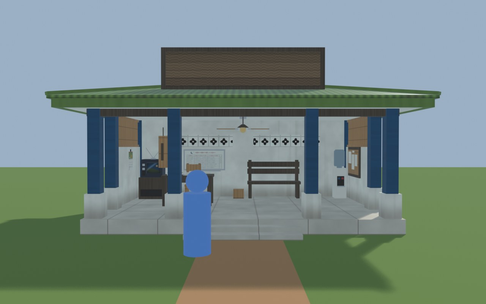
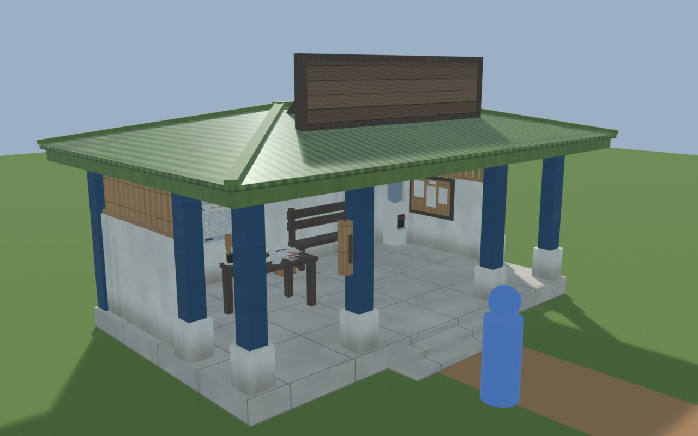
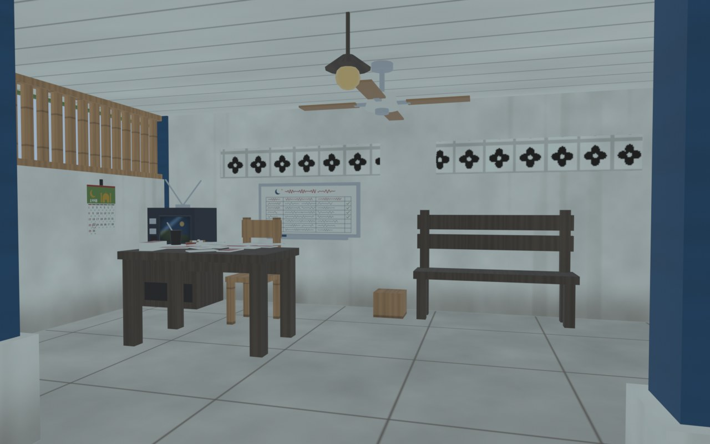
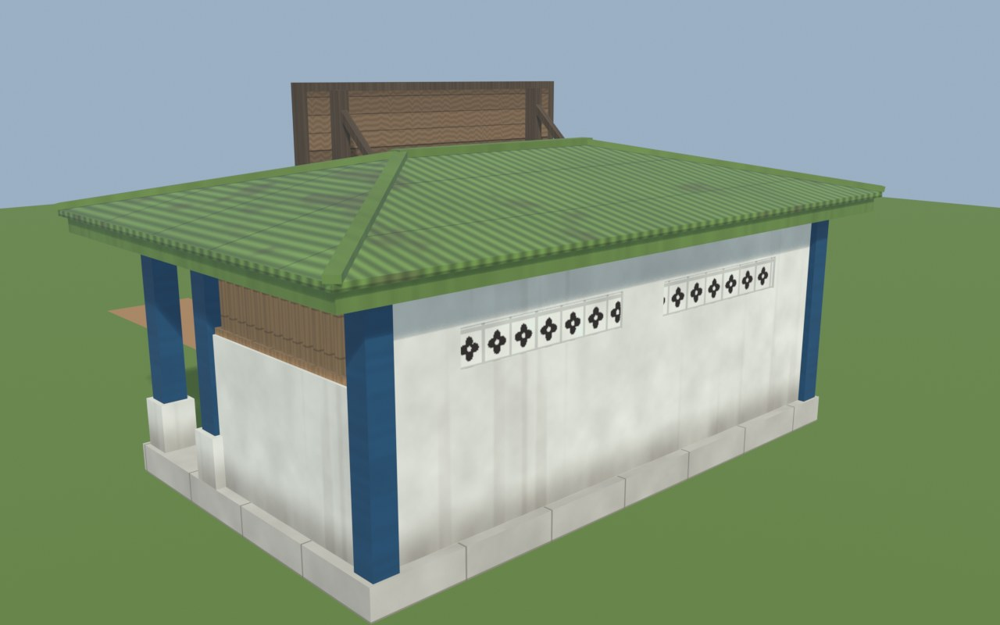
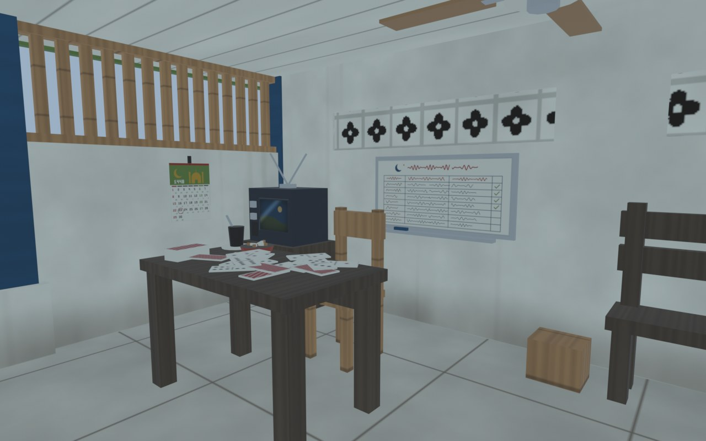
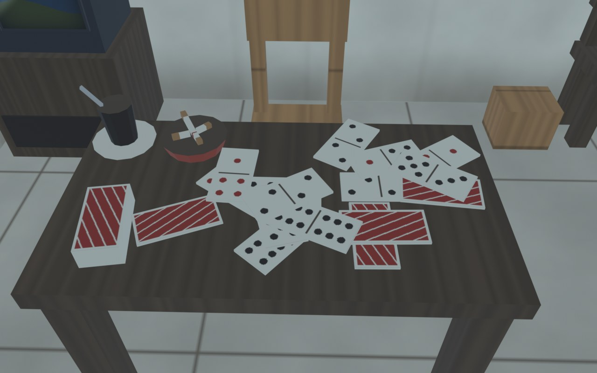
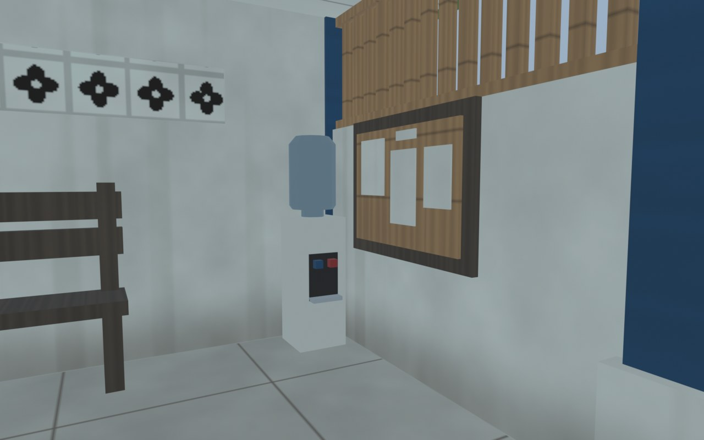

# `pos_ronda`: night-watch post (own work, Blender)

**Status: `UNVERIFIED`.** Built and rendered in Blender 5.3 only. It has not been imported into
Studio, uploaded, or reviewed by the designer. Whether it ships is @miralami's call.

Built from the reference photo Willy shared on 2026-11-23: a raised concrete platform with two steps,
blue square posts on white concrete footings, a low corrugated seng roof with green fascia and
cream ceiling boards, a sign board on the roof, a plastered back wall with two bands of flower
ventilation blocks (roster), timber slat screens above the side walls, a bench with backrest, a
table and chair, a notice board with papers, a hanging bulb and a cardboard box. A kentongan (bamboo
slit drum) hangs on the right inner post; it is not in the photo, but every pos ronda has one.

Lived-in clutter added on Willy's request: a CRT TV with rabbit-ear antenna on a low cabinet, a
water dispenser with an upside-down galon, gaple (domino) cards scattered over the table with a
squared-up pile, a glass of black coffee on a saucer with the spoon left in, a clay ashtray with
stubbed-out butts and one cigarette still burning on the rim (both placed by the script on the
clearest part of the table), a Hijri wall calendar, the night-watch roster (jadwal piket ronda) on a
whiteboard, and a four-blade ceiling fan.

| Front | Three-quarter | Inside | Back |
|---|---|---|---|
|  |  |  |  |

| TV, calendar, whiteboard, fan | Gaple, coffee and ashtray on the table | Dispenser and notice board |
|---|---|---|
|  |  |  |

The blue figure in the renders is 5.5 studs tall (avatar scale). It is not part of the asset.

## No baked words

Player text lives in `src/shared/Strings.luau` with `id` and `en`, so no texture carries words:

- The sign board is blank. `PosRonda_PapanNama` is the board's plank panel; give it a `SurfaceGui`
  on its Front face with a `TextLabel` showing `Strings.jail_title` (`id` "POS RONDA", `en`
  "GUARD POST"), white text, `tinta` stroke.
- The whiteboard roster is illegible marker scribble in a table (header, seven nights, ticks for
  the nights already done) under a crescent moon. It reads as a schedule without words.
- The calendar uses digits only: November 2026 (starts on a Sunday; Sundays red, Fridays green,
  the 23rd ringed), the Hijri day under each date (21 Jumada I to 20 Jumada II), and 1448 under a
  gold crescent and mosque. Digits are a 3 x 5 pixel font drawn by the script.

If the designer wants readable names on the roster, the cleanest route is a `SurfaceGui` on the
whiteboard with new `Strings.luau` keys, not baked text.

## Palette

Every texture is painted from the project palette (`ART.md` §3); the build script reads the hex
values from `src/shared/Config/Visuals.luau`.

| Material | Token |
|---|---|
| `Seng` roof, `Hijau` fascia and ridge caps | `daun` (roof weathered toward `tinta-lembut`) |
| `Tiang` posts | `malam`, chipped to `kertas` |
| `Plester` walls and footings, `Plafon` ceiling | `kertas` |
| `Roster` ventilation blocks | `kertas` with `tinta` holes |
| `Beton` platform and steps | `tinta-lembut` / `kertas` blend |
| `Kayu` bench, table, beams, frames | `tinta-lembut` |
| `Bambu` slats, chair, notice board, kentongan, box | `bambu` |
| `PapanNama` sign panel | `tinta-lembut` warmed toward `bambu` |
| `Lampu` bulb | `senja` |
| `Warna` small props (TV casing, knobs, antenna, dispenser, galon, fan motor), `KipasBaling` fan blades | 4 x 4 swatch atlas: one flat palette colour per cell, plus three blends (galon `malam`/`kertas`, chrome `kertas`/`indigo`, screen glass `tinta`/`indigo`) |
| `Cetak` print atlas: whiteboard, calendar, TV picture, gaple faces and back | palette colours only (`kertas`, `malam`, `merah`, `daun`, `kunyit`, `tinta`, `senja`, `indigo`) |

## Numbers

- Size: **29.9 × 15.7 × 19.6 studs** (width × height × depth). Floor 1.2 above ground, ceiling
  8.9 above the floor, sign top 15.7.
- Units: 1 Blender unit = 1 stud. Ground at z = 0, footprint centred on the origin. The open front
  faces Blender +Y, which the exporter maps to Roblox **-Z** (identity CFrame LookVector).
- 2,676 triangles in 14 meshes (14 MeshParts), 13 textures: `KipasBaling` shares the `Warna`
  atlas. All UVs inside 0..1, no n-gons, every piece closed.
- Export: FBX, Path Mode Copy, Embed Textures, FBX Unit Scale, no leaf bones, no baked animation
  (`docs/v2/plan/TOOLS.md` §2).

Rebuild from the repository root:

```powershell
blender --background --factory-startup --python assets/pos_ronda/build_pos_ronda.py
blender --background assets/pos_ronda/pos_ronda.blend --python assets/pos_ronda/render_preview.py
```

## Importing into Studio (personal copy of the place)

1. 3D Importer → `pos_ronda.fbx`, scale unit **Stud**; the preview should read about 30 × 16 × 20.
2. Anchor all parts. `Beton`, `Plester`, `Tiang` and the furniture keep collisions; `Seng`,
   `Hijau`, `Plafon`, `Lampu` can be `CanCollide = false`.
3. Add the sign `SurfaceGui` (above) and, for the night look, a warm `PointLight` (range 12 or less)
   in `PosRonda_Lampu`.
4. Optional: spin the fan. `PosRonda_KipasBaling` is only the blades, and its pivot is the fan
   axis (the four blades are symmetric), so rotating its CFrame about its own Y axis in a client
   script turns it in place. Keep it `CanCollide = false`.
5. Record the uploaded asset ID in `docs/v2/visual/art/ASSET_MANIFEST.md` (row `model.kit.pos_ronda`).
