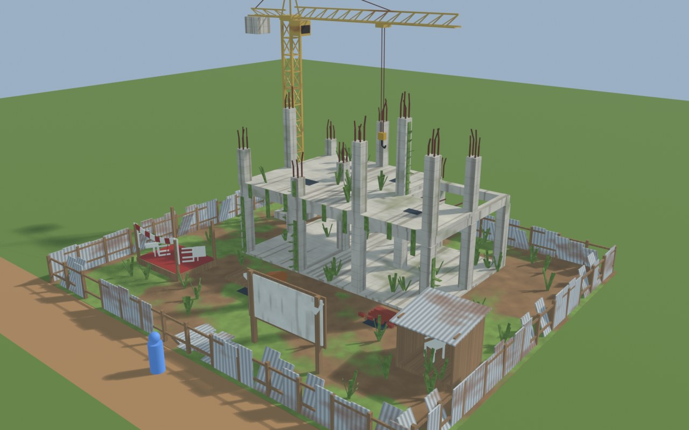
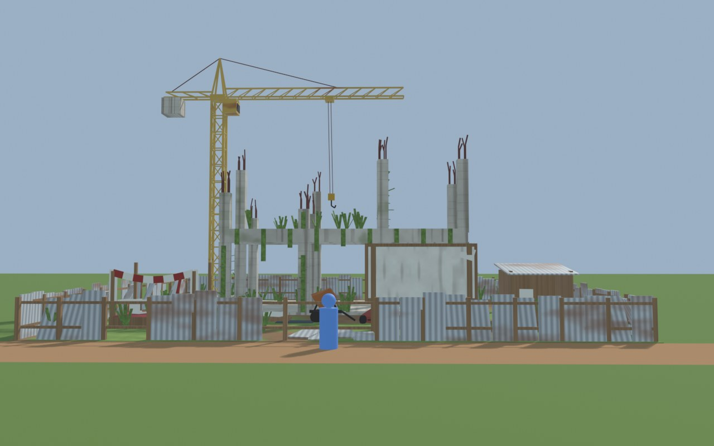
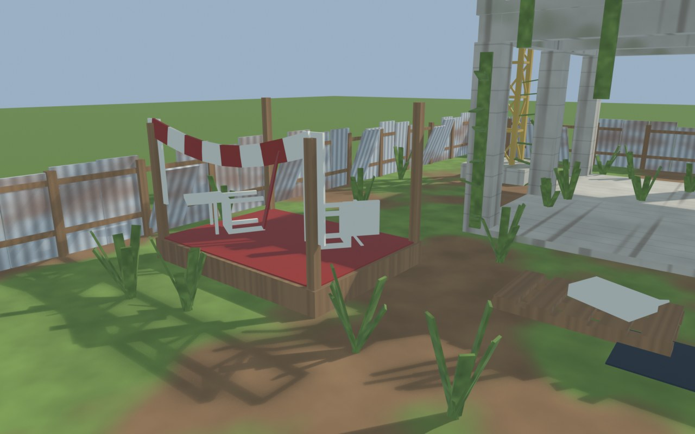
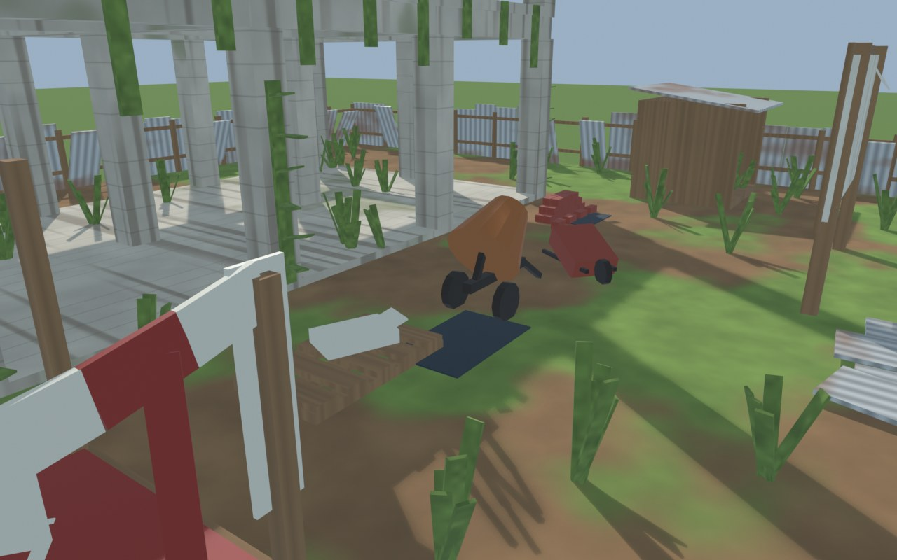
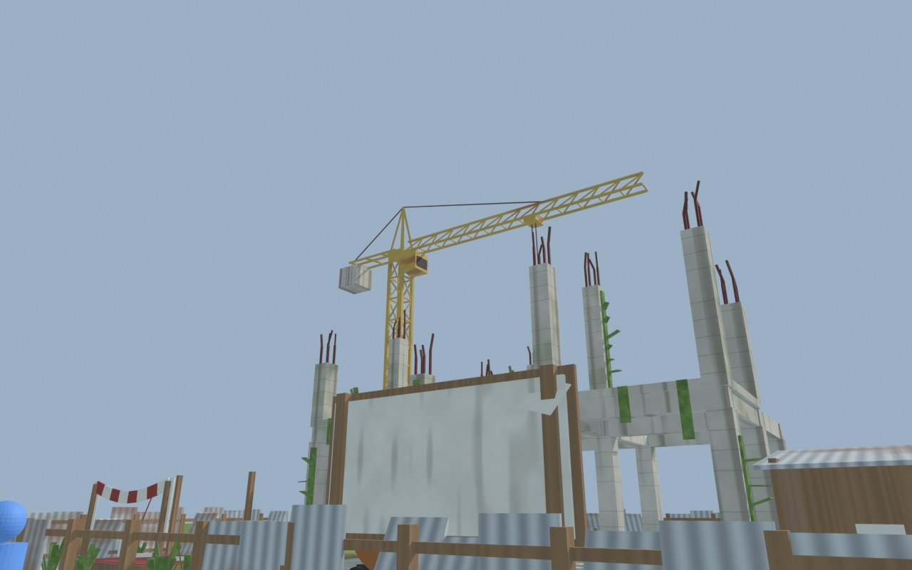
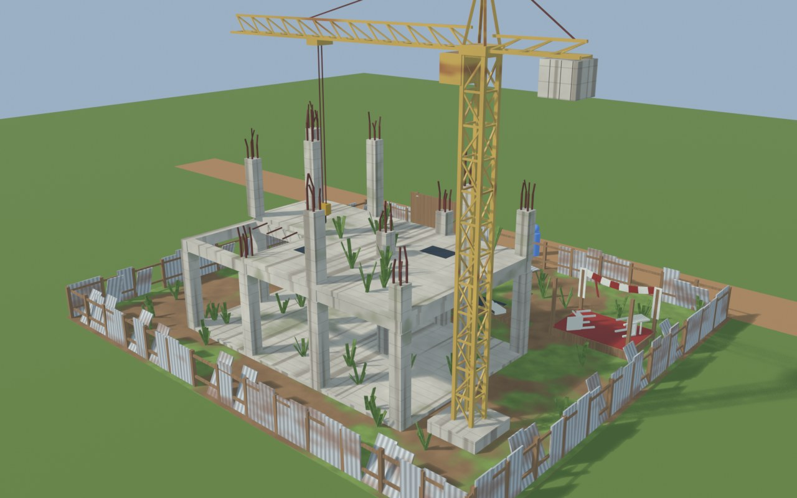

# `proyek_mangkrak`: the abandoned village project (own work, Blender)

**Status: `UNVERIFIED`.** Built and rendered in Blender 5.3 only. Not imported into Studio, not
uploaded. The concept (a GPT illustration Willy generated on 2026-11-24) has **not been approved
by @miralami yet**; this model is a candidate for that review.

The joke: a village project opened with ceremony, paid for, then left to rot. The money went
somewhere else; the cement went to Pak RT's carport (`assets/rumah_pakrt`).

- a concrete skeleton: one storey of columns and beams, a first-floor slab with one bay never
  poured, upper columns stopped at different heights with **rusty rebar** sticking out
- a **faded yellow tower crane** (missing from the illustration, added here because it is the
  landmark players see from far away), hook hanging low over the slab
- **nature taking over**: vines on columns and hanging from the slab edge, weeds across the site and
  on the slab, muddy puddles (the illustration's banana tree on the slab was left out at Willy's
  request, 2026-11-25)
- a rusty **zinc fence** on timber rails, panels leaning and fallen into the site, a gap at the road
- a **blank project board** with a corner peeling (`ProyekMangkrak_PapanProyek`, SurfaceGui target)
- the **opening-ceremony stage** left behind: red cloth, sagging red-and-white bunting, a torn
  strip, two plastic chairs knocked over
- an **empty pallet** where the aid cement was, one torn sack left
- a rusty cement mixer, an overturned wheelbarrow, a brick pile, a watchman hut with an empty
  plastic chair and a coffee glass

| Three-quarter | From the road |
|---|---|
|  |  |

| Ceremony stage | Mixer, wheelbarrow, pallet | Crane | Back |
|---|---|---|---|
|  |  |  |  |

The blue figure is **5.3 studs**, a default Roblox R15 avatar (nothing in `src/` rescales
characters). It is not part of the asset.

## Size

- **68 x 60 x 45.6 studs**: exactly the `MapSpec.luau` "proyek" footprint (x 280, z 130), so no
  map change is needed. Ground storey 12 (2.3 avatars), column tops up to about 25 plus rebar,
  crane jib at 38, apex 45.6. Fence 5.2 tall so players see into the site from the road.
- 10,856 triangles in 9 meshes (9 MeshParts), one texture each.
- 1 Blender unit = 1 stud, ground z = 0, site centred on the origin. The road side faces Blender
  +Y = Roblox **-Z**. Authored with the stage at -X and mirrored once in `main()` so that, seen
  from the road, the stage is on the left and the watchman hut on the right, as in the concept.
- Export: FBX, Path Mode Copy, Embed Textures, FBX Unit Scale, no leaf bones, no baked animation.

## No baked words

No text anywhere (Strings.luau rule): the project board, crane, fence, sack and stage are blank.
If the designer wants the project name or a budget figure on the board, add a `SurfaceGui` to
`ProyekMangkrak_PapanProyek` with new `Strings.luau` keys.

Chickens and the goat from the illustration are not modelled: the game already has animals
(`ModelMapAnimalsR8`); place them here instead.

## Palette

All textures come from `src/shared/Config/Visuals.luau` (read at build time).

| Material | Token |
|---|---|
| `Beton` skeleton, footings, counterweights | `kertas` / `tinta-lembut`, rain streaks, moss `daun` |
| `Besi` rebar, crane ties, hook rope | `genteng` / `tinta` rust |
| `Crane` | `kunyit` faded toward `kertas`, rust `genteng` |
| `Seng` fence and hut roof | `kertas` / `indigo`, rust `genteng` / `bambu` |
| `Kayu` posts, rails, stage, pallet, hut, board frame | `bambu` weathered toward `tinta-lembut` |
| `PapanProyek` | `kertas`, water stains `tinta-lembut` |
| `Tanah` ground | `bambu` / `tinta-lembut` earth under `daun` / `padi` weeds |
| `Daun` vines and weeds | `daun`, `padi` tips (blades, never balls) |
| `Warna` small props | swatch atlas: palette colours plus rust orange, muddy water and chrome blends |

## Rebuild

```powershell
blender --background --factory-startup --python assets/proyek_mangkrak/build_proyek_mangkrak.py
blender --background assets/proyek_mangkrak/proyek_mangkrak.blend --python assets/proyek_mangkrak/render_preview.py
```

## Importing into Studio (personal copy of the place)

1. 3D Importer → `proyek_mangkrak.fbx`, scale unit **Stud**; the preview should read about 68 x 46 x 60.
2. Anchor all parts. Keep collisions on `Beton`, `Kayu`, `Seng`; `Daun`, `Besi`, `Crane` (except
   the mast if players should not walk through it) and `Warna` can be `CanCollide = false`.
3. Record the uploaded asset ID in `docs/v2/visual/art/ASSET_MANIFEST.md` (row `model.kit.proyek_mangkrak`).
