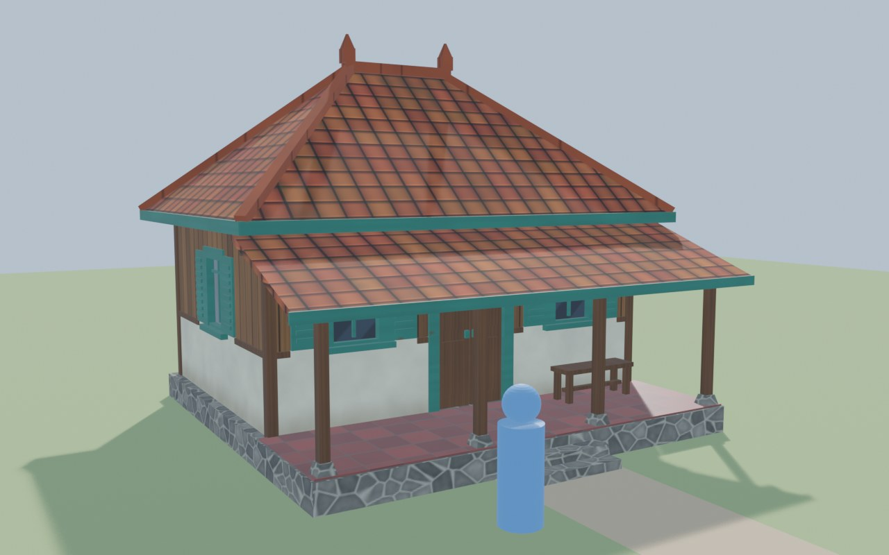
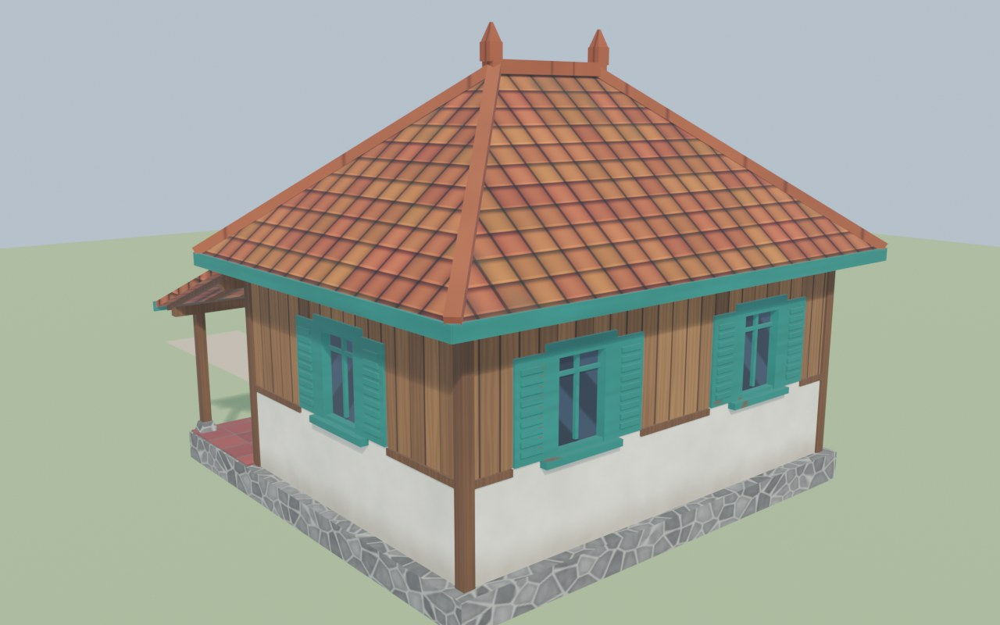
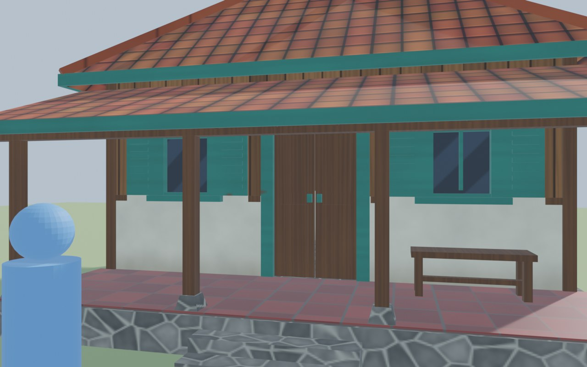

# `rumah_desa`: village house (own work, Blender)

**Status: `UNVERIFIED`.** Built and rendered in Blender 5.3 only. It has not been imported into
Studio, uploaded, or reviewed by the designer. Whether it ships is @miralami's call.

A Javanese kampung house (rumah setengah tembok): hip roof (limasan) in clay genteng with ridge caps
and crowns, a lean-to porch roof (emperan) on four timber posts with stone footings (umpak),
plastered lower walls with timber planks above, green louvred shutters (krepyak), a double timber
door, a red tile porch floor, a river-stone plinth with two steps, a porch bench (lincak) and a
hanging porch bulb.

| Front | Back | Porch |
|---|---|---|
|  |  |  |

The blue figure in the renders is 5.5 studs tall (avatar scale). It is not part of the asset.

## Files

| File | What it is |
|---|---|
| `build_rumah_desa.py` | Builds everything below from scratch. Geometry, UVs and textures are generated; nothing is downloaded. |
| `rumah_desa.fbx` | Roblox import file, textures embedded. |
| `rumah_desa.blend` | Editable source; textures are linked from `textures/`. |
| `textures/*.png` | One generated texture per material (1024 for the roof, 512 or smaller for the rest). |
| `render_preview.py` | Renders `preview/*.jpg` (ground, sun, sky and the scale figure are added for the render only). |

Rebuild from the repository root:

```powershell
blender --background --factory-startup --python assets/rumah_desa/build_rumah_desa.py
blender --background assets/rumah_desa/rumah_desa.blend --python assets/rumah_desa/render_preview.py
```

## Numbers

- Size: **25.8 × 21.4 × 26.3 studs** (width × height × depth), door 4.6 × 8.5, porch clearance ~6.7.
- Units: 1 Blender unit = 1 stud. Ground at z = 0, footprint centred on the origin.
- Front (door) faces Blender +Y, which the exporter (forward -Z, up Y) maps to Roblox **-Z**, the
  LookVector of an identity CFrame (same convention as `BUILDING_KIT.md`).
- 3,972 triangles in 10 meshes, one material and texture each, so 10 MeshParts in Studio:
  `Genteng` 32, `Wuwung` 108, `Plester` 204, `Papan` 420, `Kayu` 600, `Hijau` 2,316, `Batu` 84,
  `Tegel` 12, `Kaca` 96, `Lampu` 100. All UVs inside 0..1, no n-gons, every piece a closed box.
- Export settings follow `docs/v2/plan/TOOLS.md` §2: FBX, Path Mode Copy, Embed Textures,
  FBX Unit Scale, no leaf bones, no baked animation.

## Importing into Studio (personal copy of the place)

1. 3D Importer → `rumah_desa.fbx`. Under File Dimensions, set the scale unit to **Stud** and check
   the preview reads about 26 × 21 × 26. If it reads about 3.6 times bigger, it was taken as
   metres: switch the unit or `ScaleTo` the model.
2. Store models are untrusted, but this one is our own file: no scripts, nothing to strip.
3. Anchor all parts. Suggested collisions: `Batu`, `Tegel` and `Plester`/`Papan` keep the default
   so the porch and walls are solid; `Genteng`, `Wuwung`, `Lampu` and `Kaca` can be
   `CanCollide = false`.
4. Optional night look: put a warm `PointLight` (range 12 or less) inside `RumahDesa_Lampu`, night
   only, like the lamps in `docs/v2/visual/refs/REFERENCES.md`.
5. Record the uploaded asset ID in `docs/v2/visual/art/ASSET_MANIFEST.md` (row `model.kit.rumah_desa`).
