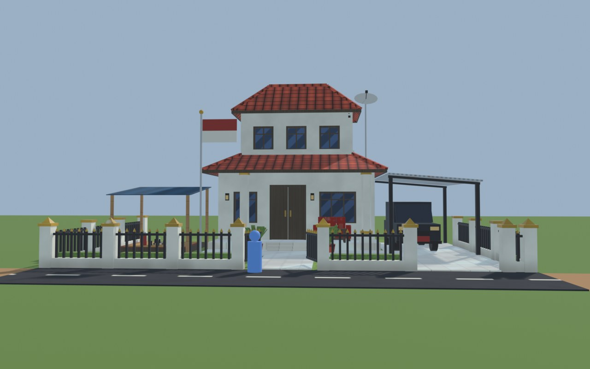
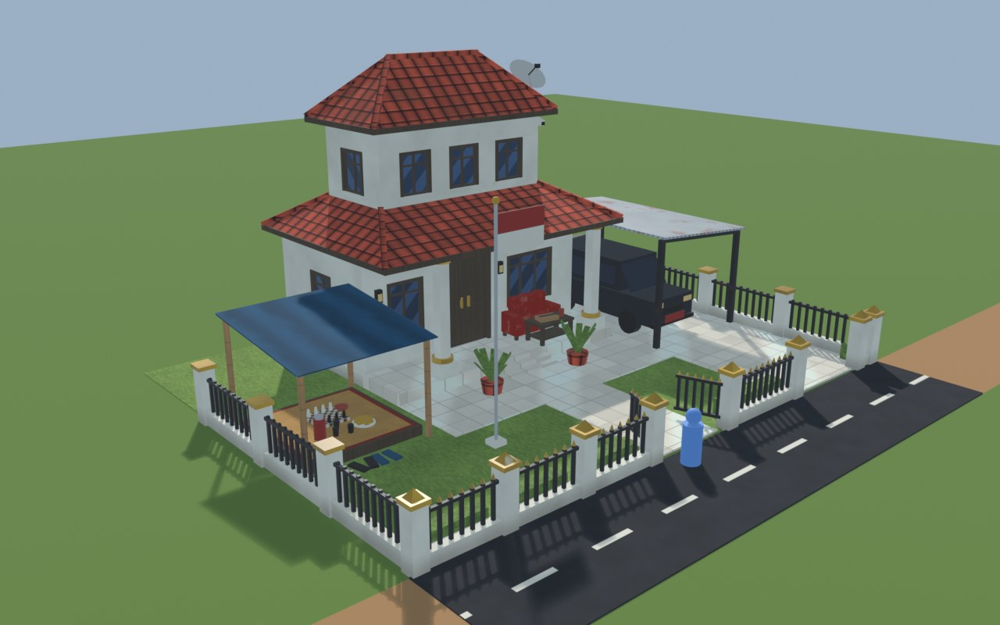
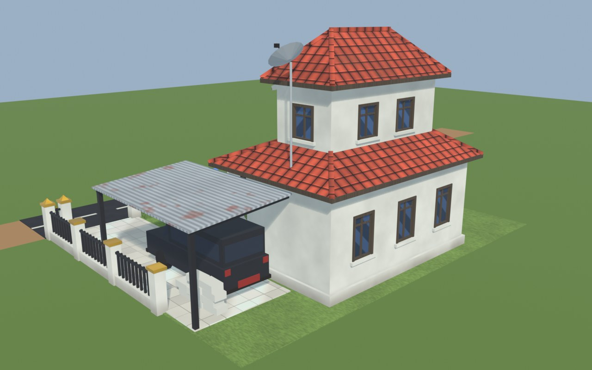
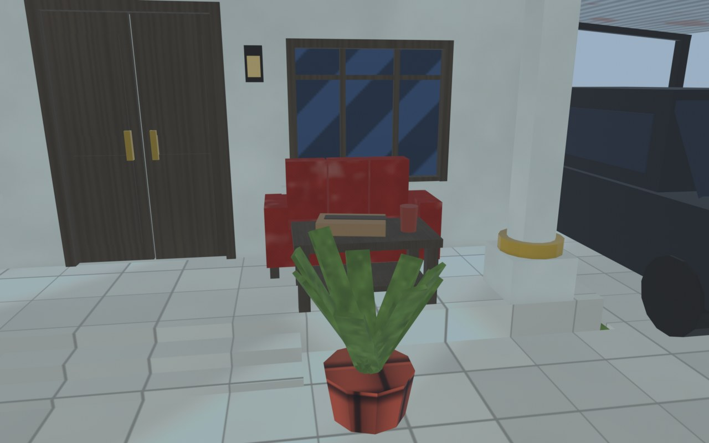
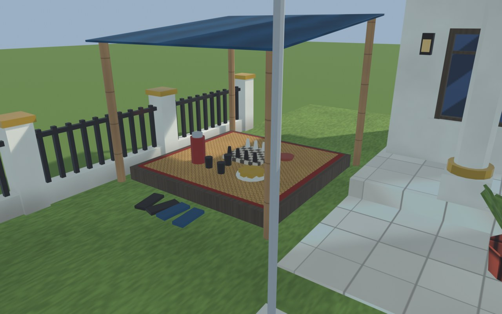
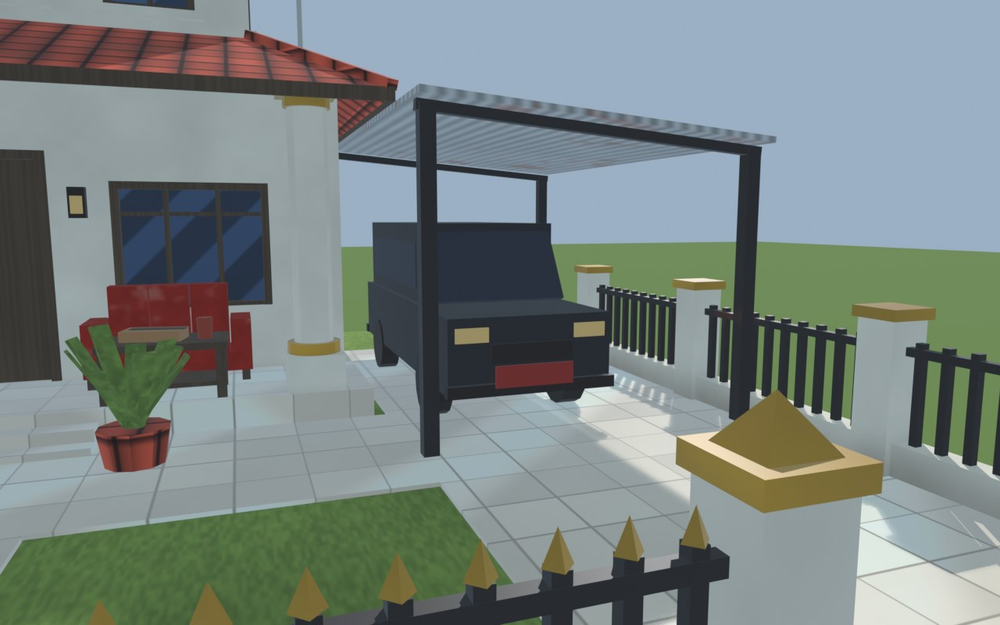

# `rumah_pakrt`: the village head's house (own work, Blender)

**Status: `UNVERIFIED`.** Built and rendered in Blender 5.3 only. Not imported into Studio, not
uploaded. The concept (a GPT illustration iterated with Willy) was approved by @miralami on
2026-11-24; whether this model ships is still her call.

The joke: Pak RT is a little corrupt, and it shows just a bit. A modest two-storey kampung house
with a big genteng roof, upgraded with money that doesn't add up:

- two plain plaster columns with **gold-painted caps** (the only gold on the house, chipped)
- a glossy tiled terrace with an **ordinary worn red sofa** and the terrace table holding a fat
  **brown envelope** and a glass of tea
- a waist-high dark iron fence on plaster pillars with **gold tips**, main gate **wide open**
- a tin carport with an older MPV on **red government plates** and stacked **village-aid cement sacks**
- a **satellite dish**, one **CCTV** camera under the upper eave, the **flag**
- smooth **asphalt only in front of this lot** (`RumahPakRT_Aspal`, optional), ending at its edges
- a humble **lesehan** hangout for villagers in the side yard: tikar on a low platform under a
  tarp on bamboo poles, thermos, coffee glasses, a plate of gorengan, a chess game, an ashtray,
  sandals left at the edge

| Street view | Three-quarter | Back |
|---|---|---|
|  |  |  |

| Terrace, sofa and envelope | Lesehan | Carport and red plate |
|---|---|---|
|  |  |  |

The blue figure is **5.3 studs**, a default Roblox R15 avatar: nothing in `src/` rescales
characters, so this is what players are. `MapSpec.luau` assumes 7.25; the house was sized
against that number, so in game it reads about 1.37 times bigger relative to the player than a
7.25 figure suggests. The figure is not part of the asset.

## Proportions (MapSpec is the authority for the house)

The house is the village scale reference in `src/server/World/MapSpec.luau`: its door, ridge
and storey heights stay at that scale. Two changes Willy asked for on 2026-11-24 go beyond the
greybox numbers:

- **Wider house** ("kurang lebar"): the ground floor is **30 wide** (was 22) and the upper storey
  **22 wide** (was 16), 16 deep. More windows (three upstairs at the front, a wide triple window
  beside the sofa), columns spaced further apart.
- **Bigger yard** to match the concept's deep front yard: lawn, wide tiled forecourt, potted
  plants, hedges inside the fence, a roomier lesehan.

| Spec | Model |
|---|---|
| Hub footprint 48 x 34 | **lot 64 x 50** (pillar caps to back fence line); front yard ~22 deep; 62 deep with the optional asphalt piece |
| Ridge 32.6 | **32.6** (ridge cap top 33.1) |
| Door 7 x 10.5 | **7 x 10.5**, double timber leaves |
| Avatar 7.25 | floor-to-floor 13.5, terrace columns 13 tall, sofa seat 2, table 2.4, fence 4.9 (chest high), carport clearance 11.6, MPV 18.5 x 7.2 x 8.5 |
| Anchor `Table` 5 x 2.4 x 3 | `RumahPakRT_Meja`, exactly **5 x 2.4 x 3**, its own MeshPart for the `BribePrompt` |

**MapSpec changes this model needs (code lane, not made in this branch; proposal for @miralami):**

- The hub at (68, 68) faces north toward RoadEast, so the extra depth goes toward the road. Keeping
  the back edge where it is (world z 85): `depth = 50`, centre `z = 60`. The new north edge is at
  z 35, still 21 studs from the road edge (z 14). The NPC spot (68, 47) falls in the front yard.
- The extra width (`width = 64`) cannot be split evenly: the west edge would land on Lapangan
  (x 36). Move the centre east to `x = 72`, so the lot spans x 40 to 104 and keeps 4 studs from
  Lapangan; the east side is open ground up to the ring road.
- The table anchor moves from `lz = 13.5` (front edge of the old greybox) to the terrace: its
  centre is **1.35 studs behind the lot centre and 6.9 studs toward the carport side** (the sofa
  and table sit right of the door, seen from the street, as in the concept).

## No baked words

Nothing carries text (Strings.luau rule): the plates are plain red, the grille has no badge, the
sacks are blank. `MapSpec` gives this hub a sign ("RUMAH PAK RT"); add it in Studio as a
`SurfaceGui` from `Strings.luau`, not as a texture.

## Palette

Every texture comes from the palette in `src/shared/Config/Visuals.luau` (read at build time).

| Material | Token |
|---|---|
| `Plester` walls, columns, fence pillars | `kertas`, splash dirt `tinta-lembut` |
| `Genteng` both roofs and ridge caps | `genteng` |
| `Kayu` doors, frames, fascia, platform; `Meja` (shares the texture) | `tinta-lembut` |
| `Kaca` windows | `indigo` |
| `Keramik` terrace, path, carport floor | `kertas` with a touch of `bambu`, glossy streak |
| `Emas` column caps, fence tips, door handles | `kunyit`, chipped to `kertas` |
| `Besi` fence, gate, carport frame | `tinta` / `indigo`, rust `genteng` |
| `Seng` carport roof | `kertas` / `indigo`, rust `genteng` |
| `Terpal` lesehan tarp | `malam` |
| `Tikar` mat | `bambu` / `kunyit` weave, `merah` border |
| `Bambu` poles | `bambu` |
| `Sofa` | `merah`, faded toward `kertas` |
| `Catur` board | `tinta-lembut` / `kertas` |
| `Aspal` | `tinta` / `indigo`, `kertas` centre dashes |
| `Rumput` lawn | `daun` / `padi` |
| `Daun` hedges and potted plants | `daun`, `padi` tips (leaf blades, never balls) |
| `Warna` small props; `Mobil` (shares the atlas) | 4 x 4 swatch atlas: palette colours plus three blends (car glass, chrome, car paint) |

## Numbers

- 10,304 triangles in 19 meshes (19 MeshParts), 17 textures (`Meja` shares `Kayu`, `Mobil`
  shares `Warna`). All UVs inside 0..1, no n-gons, every piece closed.
- 1 Blender unit = 1 stud, ground z = 0, lot centred on the origin. The street side faces Blender
  +Y, which the exporter maps to Roblox **-Z**. The layout is authored with the carport at +X and
  mirrored once in `main()` so the lesehan is on the left and the carport on the right, as in the
  concept.
- Export: FBX, Path Mode Copy, Embed Textures, FBX Unit Scale, no leaf bones, no baked animation.

Rebuild from the repository root:

```powershell
blender --background --factory-startup --python assets/rumah_pakrt/build_rumah_pakrt.py
blender --background assets/rumah_pakrt/rumah_pakrt.blend --python assets/rumah_pakrt/render_preview.py
```

## Importing into Studio (personal copy of the place)

1. 3D Importer → `rumah_pakrt.fbx`, scale unit **Stud**; the preview should read about 64 x 33 x 62
   (50.5 deep without `RumahPakRT_Aspal`; delete that part if the map road should stay as it is).
   `RumahPakRT_Rumput` is a thin lawn over the lot; drop it if the terrain grass is enough.
2. Anchor all parts. Keep collisions on `Plester`, `Keramik`, `Besi`, `Kayu`, `Meja`, `Mobil`,
   `Sofa`; `Genteng`, `Seng`, `Terpal`, `Emas`, `Warna` can be `CanCollide = false`.
3. Put the `BribePrompt` on `RumahPakRT_Meja` and the hub sign `SurfaceGui` where the designer wants it.
4. Record the uploaded asset ID in `docs/v2/visual/art/ASSET_MANIFEST.md` (row `model.kit.rumah_pakrt`).
