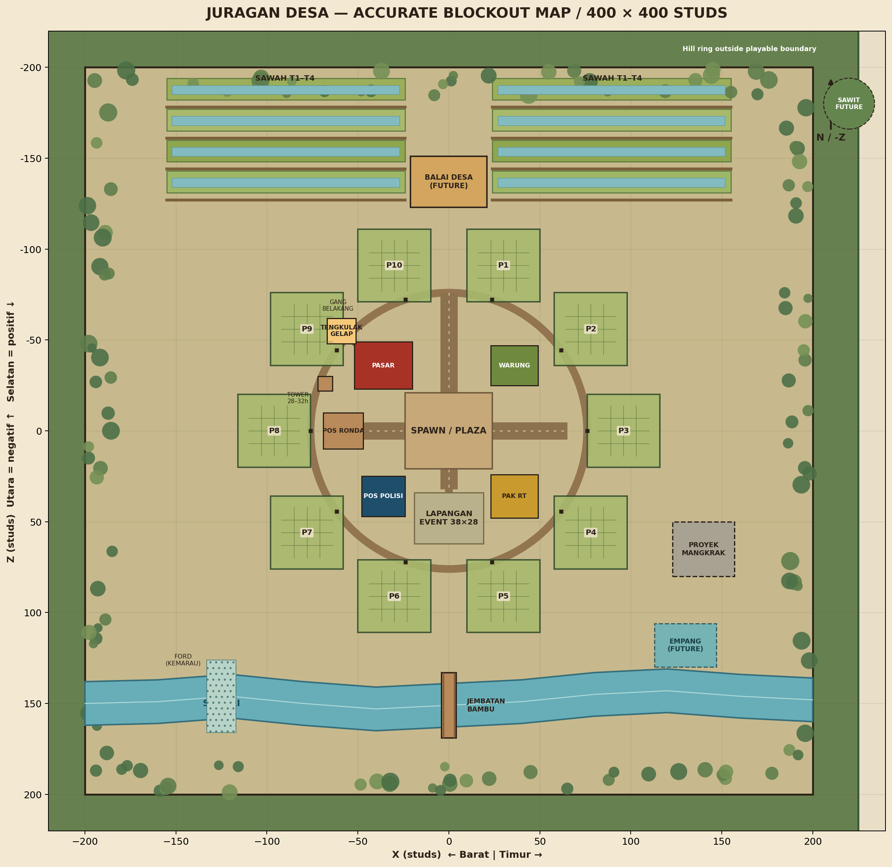
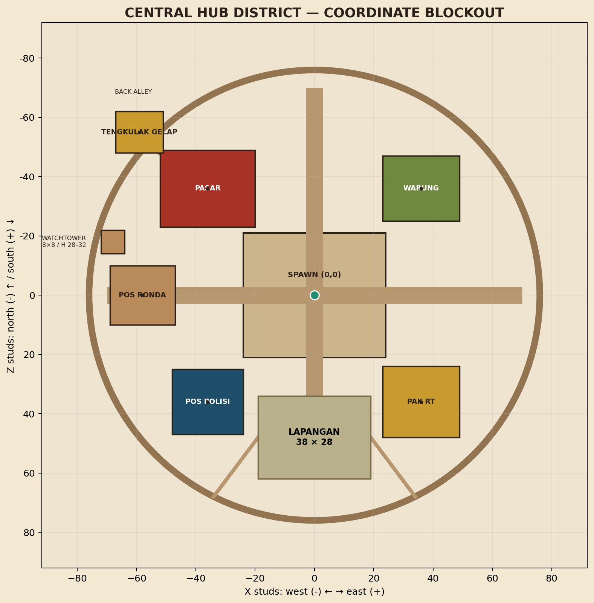
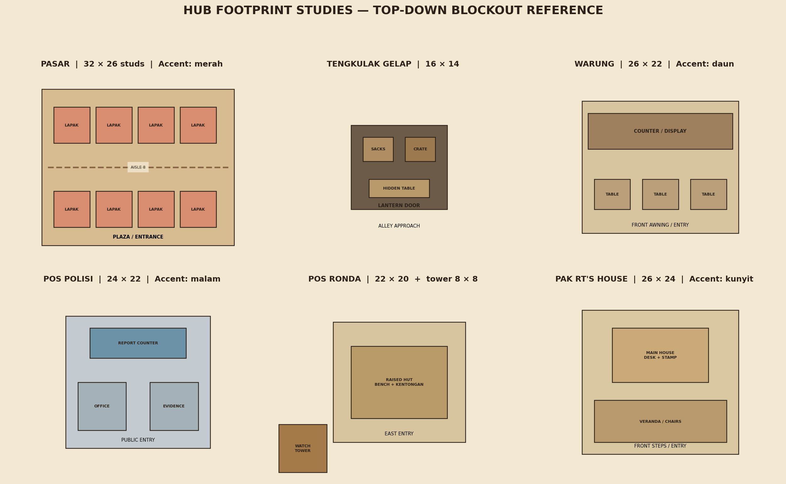
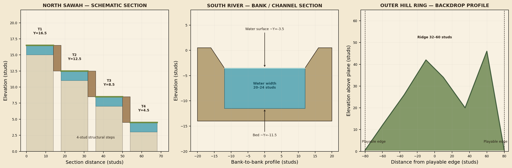
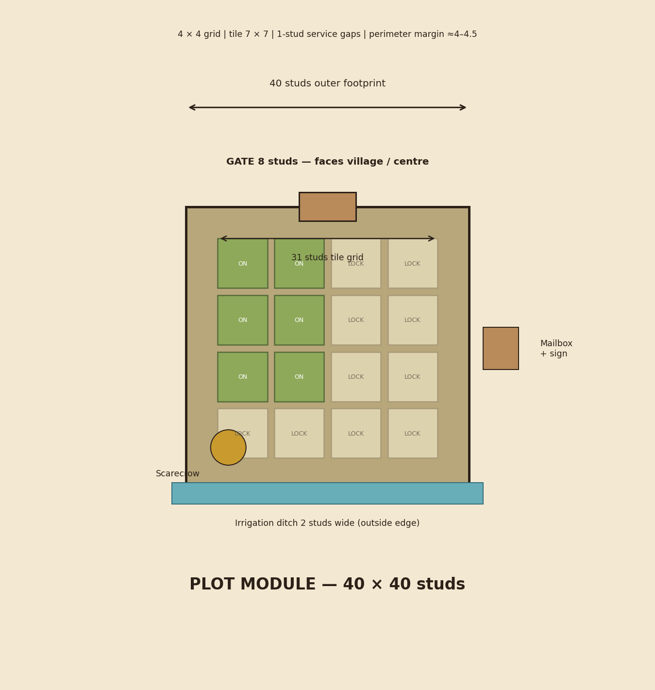

# JURAGAN DESA — MAP DESIGN BRIEF

**Dokumen:** Level / Environment Design Brief  
**Target:** Roblox Studio · Stylized multiplayer farming game · Maks. ±10 pemain/server  
**Unit:** studs · **Arah:** Utara = -Z, Timur = +X  
**Status:** Rancangan blockout v1.0 — seluruh koordinat merupakan spesifikasi awal yang dapat di-tweak setelah greybox playtest.

> **Catatan otoritas desain:** tabel koordinat dan ukuran pada dokumen ini adalah sumber kebenaran untuk blockout. Ilustrasi/poster konsep hanya referensi suasana dan komposisi; teks kecil/label di dalam ilustrasi AI dapat keliru dan tidak boleh mengalahkan angka dalam brief.

---

## 1. Design intent

Juragan Desa harus terasa seperti desa Indonesia yang akrab, hangat, sedikit berantakan, dan penuh karakter, bukan farm simulator generik yang hanya diberi tekstur lokal. Dalam 30 detik pertama, pemain melihat pusat desa dengan pasar merah, atap genteng, warung, jalan tanah, dan plot pertanian yang mengelilingi pusat aktivitas. Pemain langsung memahami tiga hal: lahan pribadi ada di pinggir pusat desa, pasar adalah tempat menjual hasil panen, dan bangunan publik adalah tempat gosip/urusan sosial terjadi. Siluet menara bambu, kanopi pasar, dan sawah bertingkat menjadi penanda orientasi utama dari jarak jauh. Satire hadir lewat detail lingkungan serta interaksi NPC—korupsi kecil, pinjol, tetangga kepo, dan proyek mangkrak—tetapi dunia tetap cerah, lucu, dan tidak grim. Hero shot thumbnail memperlihatkan seorang petani di depan tanaman berwarna-warni, pasar desa di midground, dan sawah bertingkat plus bukit di background pada cahaya senja. Momen emosional visual adalah panen bertier **SULTAN** yang muncul dengan efek kecil, sementara pemain lain berkumpul di belakangnya.

**Player fantasy:** mulai sebagai Gurem, belajar mengelola lahan, berdagang, memperluas plot, dan menjadi Juragan yang punya uang, reputasi, serta masalah sosial lebih besar.

**Mood words:** warm, handmade, busy-but-readable, cheeky, communal, Indonesian rural life.

## 2. Top-down layout

### 2.1 Koordinat dan batas



*Diagram ini dibuat dari koordinat tabel pada brief; gunakan sebagai peta blockout, bukan sebagai final art.*

- Playable square: X = -200 sampai +200; Z = -200 sampai +200.
- Gameplay ground plane: Y = 0.5. Spawn, hub floors, roads, plaza, and plot floors tetap di Y = 0.5.
- Utara ada di -Z; selatan ada di +Z; timur +X; barat -X.
- Hill ring adalah backdrop di luar playable square. Jangan menjadikan lereng luarnya sebagai jalur pemain pada rilis awal.
- Hub cluster berada pada radius sekitar 44–58 studs, sedikit lebih renggang dari build lama agar footprint tidak memotong jalan.
- Sepuluh plot berada di ring radius sekitar 96 studs.

### 2.2 Schematic map (not to scale)



*Inset ini untuk membaca hubungan jarak antarfasilitas; seluruh ukuran/koordinat rinci tetap mengikuti tabel.*

```text
                                NORTH (-Z)
       HILL / FOREST RING - OUTSIDE PLAYABLE BOUNDARY
  +----------------------------------------------------------+
  |        TERRACED SAWAH: 4 LEVELS, NORTH-NORTHWEST         |
  |     T1       T2       T3       T4   (central gap/path)    |
  |                                                          |
  |   P10              BALAI DESA (FUTURE)              P1    |
  |      P9                                           P2     |
  |                                                          |
  | POS RONDA + TOWER    BLACK MARKET / PASAR       WARUNG   |
  |      P8                [CENTRAL PLAZA]             P3     |
  |                                                          |
  | POS POLISI             SPAWN / CROSSROADS          PAK RT|
  |      P7                                           P4     |
  |                                                          |
  |                 LAPANGAN / EVENT APRON                    |
  |                P6                     P5                 |
  |                                                          |
  |       PROYEK MANGKRAK (FUTURE)     EMPANG (FUTURE)        |
  |                                                          |
  | ~~~~~~~~~~~~~~~~ RIVER + BAMBOO BRIDGE ~~~~~~~~~~~~~~~~~ |
  +----------------------------------------------------------+
       HILL / FOREST RING - OUTSIDE PLAYABLE BOUNDARY
                                SOUTH (+Z)
```

### 2.3 Main map coordinates

| Element | Centre / line | Footprint / dimensions | Notes |
|---|---:|---:|---|
| Spawn | (0, 0) | Spawn radius 5 | Face north-northwest toward village life; keep camera clear |
| Central plaza | (0, 0) | 48 × 42 | Road crossing, spawn buffer, gathering space |
| Main road East-West | Z = 0 | 18 wide; central span to connector | Dirt / compacted earth |
| Main road North-South | X = 0 | 18 wide; central span to connector | Dirt / compacted earth |
| Outer plot connector | Approx. radius 76 | 8 wide | Connects plot gates; bends around event apron |
| Lapangan / event apron | (0, 48) | 38 × 28 | Public gathering, raid/debt-collector witness point; not a building |
| Balai Desa future | (0, -137) | 42 × 28 | Reserved slot; later elected Kepala Desa / village funds |
| Proyek mangkrak future | (140, 65) | 34 × 30 | Concrete skeleton / unfinished monument |
| Empang future | (130, 118) | 34 × 24 | Pond cluster near river; keep bank access |
| Sawit concession future | (220, -180) | Off-map hill silhouette | Outside playable square; connect in a later release or separate area |
| River centreline | Curves around Z = 145–155 | Water width 20–24 | Runs west-to-east across south |
| Bamboo bridge | (0, 151) | Deck 8 × 36 | Primary river crossing |

### 2.4 Six hub locations

| Hub | Centre (X,Z) | Footprint | Entrance orientation | Reason |
|---|---:|---:|---|---|
| Pasar | (-36, -36) | 32 × 26 | Southeast | Near the plaza but offset from road centreline |
| Tengkulak Gelap | (-59, -55) | 16 × 14 | Southeast via alley | Hidden behind/alongside market; not a global landmark |
| Warung | (36, -36) | 26 × 22 | South / southwest | Close to spawn; social and rumour stop |
| Pos Ronda | (-58, 0) | 22 × 20 | East | Visible from western approach; tower provides orientation |
| Pos Polisi | (-36, 36) | 24 × 22 | North | Near plaza and short path to plot ring |
| Rumah Pak RT | (36, 36) | 26 × 24 | Northwest | Prominent but slightly removed from market noise |

**Layout reason:** four primary buildings sit in the diagonal quadrants around the crossing; Pos Ronda uses the west spur; black market uses a narrow back alley. No building footprint should intrude into the 18-stud road corridor. The current hub radius is intentionally widened from the old 25–35-stud cluster; it remains a short walk while allowing recognizable silhouettes and prop dressing.

### 2.5 Ten plot sites

Plot centres are arranged at roughly 36-degree intervals around a radius-96 ring. Each plot is 40 × 40 studs, with a radial inward-facing entrance.

| Plot | Centre (X,Z) | Radius | Gate faces | Approx. neighbour chord |
|---|---:|---:|---|---:|
| P1 | (30, -91) | 95.8 | Southeast | 56–57 |
| P2 | (78, -56) | 96.0 | Southwest | 56–57 |
| P3 | (96, 0) | 96.0 | West | 56–57 |
| P4 | (78, 56) | 96.0 | Northwest | 56–57 |
| P5 | (30, 91) | 95.8 | Northwest | 56–57 |
| P6 | (-30, 91) | 95.8 | Northeast | 56–57 |
| P7 | (-78, 56) | 96.0 | Northeast | 56–57 |
| P8 | (-96, 0) | 96.0 | East | 56–57 |
| P9 | (-78, -56) | 96.0 | Southeast | 56–57 |
| P10 | (-30, -91) | 95.8 | Southeast | 56–57 |

**Road-to-plot connection:** the two 18-stud roads form a clean central cross. At the inner edge of the ring they meet an 8-stud connector loop at approximately radius 76. Each plot opens inward to that loop. The south arm stops at the Lapangan entrance; short pedestrian links leave the Lapangan side edges to rejoin the ring connector, so the main road does not cut through the crowd area. Small 6-stud spurs connect the loop to plot gates. This preserves the ring, avoids road/plot overlap, and gives emergency NPCs a continuous path.

### 2.6 Why each zone is where it is

- **North:** sawah terraces make a strong natural backdrop and provide a clear north-facing destination. Balai Desa occupies a central gap between the terrace banks so it can become a civic landmark later.
- **Centre:** spawn, road cross, and plaza provide the social anchor. The most-used services are within a short walking radius.
- **West:** Pos Ronda and tower are visible from several plot sites; black market is concealed in the west/northwest market alley.
- **East:** Warung and Pak RT are visible from the eastern plots and create a social/economic pair.
- **South:** open Lapangan creates a place for 10-player crowds; river and bridge become the major scenic terminus.
- **Southeast edge:** future empang and unfinished project use the quieter agricultural edge without crowding the central loop.

## 3. Player flow and pacing

### 3.1 Movement assumptions

For travel estimates, assume a baseline character speed of **16 studs/second**. This is a planning assumption, not a required WalkSpeed; recalculate if the game uses a different movement speed. Route times include a small allowance for corners and avoiding other players.

| Trip | Approx. route distance | Expected walk time | Design goal |
|---|---:|---:|---|
| Spawn → Pasar | 50 studs | 3–4 sec | Very short |
| Spawn → Warung | 52 studs | 3–4 sec | Very short |
| Spawn → Pos Polisi | 55 studs | 4 sec | Very short |
| Spawn → Pos Ronda | 65 studs | 4–5 sec | Short |
| Spawn → first plot | 105–115 studs | 7–8 sec | Short, feels like leaving the village centre |
| Pasar → nearest plot gate | 75–105 studs | 5–7 sec | Short |
| Warung → Pos Polisi | 95–110 studs | 6–7 sec | Short social trip |
| Pasar → Tengkulak alley | 35–40 studs | 2–3 sec | Hidden but accessible |
| Spawn → river bridge | 155–175 studs | 10–12 sec | Scenic walk, not daily chore |

The first farm trip should feel immediate. Avoid a tutorial that makes players walk to the far sawah or river before they have planted once.

### 3.2 Tutorial beats

1. **Spawn / 0:00–0:20:** camera frames the market canopy, one visible plot entrance, and a clear objective marker. The player receives a small seed bundle and a simple “Tanam 3 benih” objective.
2. **Plant / 0:20–1:00:** follow a short path to the player's assigned plot. Keep the tutorial prompt near the first unlocked 2×3 block of tiles. A single touch-friendly interaction plants the seed.
3. **Harvest / 1:00–2:30:** let the player perform a short first harvest. Use a clear tier reveal: Biasa first, with a low chance of a better result only after the player understands the mechanic. The reveal needs a brief audio/visual cue, not a long full-screen interruption.
4. **Sell / 2:30–3:30:** a sign or NPC points to Pasar. The player sees the selling value before confirming. Show currency gained and inventory count updated.
5. **Loan offer / after first sale:** Warung or the Phone app introduces BayarLater as a cheeky optional offer. Do not force a loan during the first minute; explain repayment and consequences before acceptance.
6. **Neighbour raid witness / after the first sale or first rank progress:** a scripted raid is triggered on an NPC/tutorial plot. The police leave Pos Polisi and walk the route; the camera briefly zooms; a “BREAKING NEWS” banner appears server-wide. Players can gather at the target plot's witness bay.
7. **Warung rumour / after raid:** an NPC mentions a suspiciously profitable neighbour or black-market seed. This hints at cheating without a wall of text.
8. **Rank-up:** rank changes should appear at the plot or market after a visible milestone. The player's plot border/sign updates to show their status.

### 3.3 Core loop pacing

- Planting: interaction is immediate; no extra menu for each tile.
- Growing: provide visible stage changes and optional short side activities.
- Harvest: quick burst of feedback; rarity reveal is the signature “wow” moment.
- Selling: one short route to market, transparent price, one clear confirmation.
- Expansion: show the next tile/plot upgrade target on the player's land.
- Social satire: occasional event rather than constant interruption. A raid should feel like a special server moment, not a repeated nuisance.

## 4. Sightlines and landmarks

### 4.1 Hub silhouette / accent / visibility

| Hub | Silhouette | Single accent | Height target | First visible from |
|---|---|---|---:|---|
| Pasar | Broad double-row market canopy with two red spanduk poles | Merah `#A83226` | Roof ridge 18–20 | Spawn plaza and most inner paths |
| Tengkulak Gelap | Narrow recessed door, slanted zinc awning, one hanging lantern | Senja amber `#F6C97A` against dark wood | Awning 8–10 | Only from market back lane; intentionally secretive |
| Pak RT | Large hipped genteng roof, raised veranda, gold trim | Kunyit `#C99A2E` | Roof ridge 17–19 | East/southeast plots and plaza |
| Pos Polisi | Compact office with blue fascia, simple pole/sign silhouette | Malam blue `#1F4E6B` | Roof 14–16; sign 18 | West/southwest plots and plaza |
| Pos Ronda | Open bamboo hut with grass roof plus separate watchtower | Bambu `#B98A5A` | Hut 11–13; tower 28–32 | West, north-west, and several south-west plot views |
| Warung | Recognizable zinc/tile roof, awning, open counter | Daun `#6F8A3F` | Roof 14–16 | Spawn, east plots, central connector |

Every hub uses neutral kertas/wood/ink as base and only one accent hue as the dominant identifier. Avoid combining multiple saturated accent colours on one facade.

### 4.2 Plot-to-landmark guarantee

| Plot group | Landmark guaranteed in view | Conditions |
|---|---|---|
| P1 / P10 | Pos Ronda tower or sawah ridge | Keep tree canopy below 8 studs in the sightline wedge |
| P2 / P3 | Warung roofline or Pak RT roof | Keep the east approach free of tall props |
| P4 / P5 | Pak RT roof / blue Pos Polisi sign | Low hedge and no tall tree directly behind plot gate |
| P6 / P7 | Pos Polisi silhouette / Pos Ronda tower | Keep the west-side approach open |
| P8 / P9 | Pos Ronda tower / Pasar banners | Avoid building a tall wall or dense tree line on west arc |

From any plot, the player should see at least one hub, tower, or terrace ridge. If a plot loses its landmark due to seasonal fog, keep a nearer signpost or pennant visible.

### 4.3 Three hero view corridors

1. **Spawn → Pasar:** from (0,0) toward (-36,-36), ending at the red market canopy and spanduk. Keep the corridor at least 18 studs wide, with no tree canopy below 14 studs inside the view wedge.
2. **North connector → Balai Desa → Sawah:** from the north end of the central loop toward (0,-137), framed by the two terrace banks. The view terminates at the upper terrace and forest ridge. Preserve a 42-stud central gap between terraces for the future hall and path.
3. **Lapangan → Bamboo Bridge → River:** from (0,48) toward (0,151). End at the water reflection and low southern hill gap. Keep this corridor free of large trees, tall billboards, and opaque props; this is the sunset postcard view.

## 5. Zoning and social space

### 5.1 Density zones

| Zone | Density | Design rule |
|---|---|---|
| Market / hub cluster | High | Many small props near edges; central walking lines remain open |
| Central plaza | Medium-low | Open floor, readable routes, no large props in the middle |
| Plot ring | Medium | Fences, mailboxes, crops, small sheds; neighbour plots remain visible |
| Sawah | Low-medium | Long readable bands, water and levees; avoid clutter between terraces |
| River / bridge | Low | Natural edge dressing and open water view |
| Hill / forest ring | High at boundary | Backdrop silhouettes; avoid blocking the three corridors |

### 5.2 Social crossing points

- **Market forecourt:** primary trading encounter. Provide a clear 30 × 20-stud standing area outside stalls.
- **Central plaza:** central orientation and announcement area. Keep a 32 × 24-stud crowd zone clear; 10 avatars should be able to stand in two loose rows without clipping.
- **Warung frontage:** social and rumour stop, with two tables and a clear 12 × 16-stud standing patch.
- **Lapangan / event apron at (0,48):** 38 × 28 studs, open ground with a low stage edge, notice pole, and a TV-crew camera tripod prop. This area supports 10 players for public event viewing.
- **Plot witness bay:** at each plot entrance, reserve a 18 × 12-stud apron between the gate and connector path. During raids/debt collection, players gather here without standing on crop tiles.

### 5.3 Server-wide drama staging

A raid is physically performed at the target plot: police exit Pos Polisi, walk via the central plaza and connector loop, stop outside the plot gate, then the camera zoom and banner trigger. Do not teleport the police directly beside the target plot; the walk is part of the comedy. All players receive a brief “BREAKING NEWS” banner, while nearby players can watch from the plot witness bay. A small market-facing notice board can show the headline after the event. Debt collection is similar but more intimate: the collector stands just outside the player's gate, with a server-wide notification and optional camera beat. Never let the collector stand on crops or block the only gate.

## 6. Terrain profile



*Atlas footprint di atas menunjukkan hubungan ruang masing-masing hub secara top-down. Detail props tetap mengikuti kartu hub pada Section 7.*

### 6.1 Terrain rules



*Cross-sections are schematic; exact heights and widths are specified below.*

Roblox Smooth Terrain uses 4 × 4 × 4-stud voxels. Keep structural terrain changes snapped to 4-stud increments; do not use tiny height changes to describe a landform that the terrain grid cannot express. The playable gameplay plane remains Y = 0.5. Terraces, banks, and decorative hills may rise/fall around it, but the plot pads, roads, hub floors, central plaza, and bridge approach remain accessible and readable.

### 6.2 North sawah terraces

- Overall zone: roughly X = -150 to +150, Z = -195 to -123, with a 42-stud central gap for the future Balai Desa and north path.
- Four parallel terraces, each 12–14 studs deep in Z, separated by 4-stud bunds/retaining lips.
- Terrace floor levels, north to south: Y = 16.5, 12.5, 8.5, 4.5. Each structural step is 4 studs.
- Each terrace bank is split into west and east field sections so the central gap remains clear.
- Water surface: shallow, roughly 1–2 studs above basin floor in Hujan; lower in Kemarau. The basin/bund geometry stays fixed.
- Each terrace needs a 4-stud bund crest, narrow footpath, and irrigation inlet/outlet. Connect levels with an 8-stud zig-zag maintenance ramp at the east edge; slope gradually across 12–16 studs of run per 4-stud rise rather than forcing a sheer climb.
- Show reflections from the sky and low sun, but do not place a large opaque water plane that hides the rice-bed texture.
- Use the central north corridor as a view corridor and future civic approach, not as another farm tile.

### 6.3 South river

- Centreline runs west-to-east with a gentle meander: (-200,150), (-120,146), (-40,153), (40,151), (120,143), (200,148).
- Visible water width: 20–24 studs; full bank-to-bank corridor including slopes: approximately 40 studs.
- Channel bed target: Y = -11.5. Water surface target in normal conditions: about Y = -3.5 (8-stud water column), subject to voxel occupancy / appearance tuning. Banks transition from Y = 0.5 down in 4-stud steps.
- Bank form: roughly 8 studs of sloped/stepped earth per side, with exposed soil, grass tufts, rounded stones, and occasional roots. Avoid a vertical cliff edge.
- Flow direction: visually west to east. Add subtle foam/texture variation; no need for high-cost moving meshes.
- Bamboo bridge at (0,151): 8-stud deck width, 36-stud total crossing length (including short bank approaches), deck around Y = 1.5. Use bamboo side rails, plank deck, and two visible support frames. Ramps/approaches should be no steeper than a comfortable walking slope.
- Primary ford: around (-125,146), 16 studs wide along X and about 40 studs long across Z (bank-to-bank), with flat stepping stones, only safe/obvious in Kemarau. In Hujan it appears flooded and should visually discourage crossing.
- Secondary future crossing: near (+135,145), leave the bank dressing open for later content but do not build a second full bridge in v1.
- Sunset reflection: keep the west-to-east water corridor visually open; place low reeds and stones at the edges, not tall trees across the river.

### 6.4 Hill ring / forest

- Backdrop begins outside the playable square, around 210–230 studs from the map centre, and rises to 32–60 studs above the gameplay plane.
- Build broad, soft hill masses with 4-stud height steps, not sharp spikes. Keep the visible ridge profile varied: low saddle to the southwest, higher tree-covered shoulder to the northwest and east.
- Forest clumps sit on the outer edge and at the corners. Trees near the playable edge should be in groups, not evenly spaced around the boundary.
- Leave a low gap at the southwest/west-southwest horizon to preserve the sunset river corridor. Keep the north central ridge low enough that the terrace skyline remains visible.
- Future sawit concession is a silhouette on the northeast outer hill at approximately (220,-180); it is off-map until a later expansion.

## 7. Per-hub dressing cards

### 7.1 Pasar — footprint 32 × 26, centre (-36,-36)

**Accent:** Merah `#A83226`. **Silhouette:** broad double-row canopy, two red spanduk poles, open central aisle. **Ground:** compacted earth with a 6-stud stone/paving strip at the entrances. **Dusk light:** two warm hanging bulbs under the main canopy.

Props (use 8–12):
1. 8–10 produce stalls made from a repeatable 6 × 6 module.
2. Red fabric banners/spanduk on two poles.
3. Wooden produce crates and woven baskets.
4. Hanging price board with large icons/numbers, not paragraphs.
5. Mechanical weighing scales.
6. Sacks of rice, cassava, and corn near the back wall.
7. Two parked motorbikes at the outer edge.
8. Refillable gallon water jugs near a stall.
9. Tarpaulin awnings and rope tie-downs.
10. Small waste basket / vegetable scraps at the rear.

**Story detail:** one weighing scale has a tiny stone hidden under its foot, subtly hinting that a seller is cheating the weight. Keep it readable only when close.

### 7.2 Tengkulak Gelap — footprint 16 × 14, centre (-59,-55)

**Accent:** Senja `#F6C97A` as lantern light; dark ink-brown facade remains dominant. **Silhouette:** recessed side door, narrow slanted zinc awning, one lantern. **Ground:** darker packed earth and uneven brick; 6-stud alley. **Dusk light:** single lantern above the door, warm pool of light.

Props:
1. Hanging lantern.
2. Two stacked burlap sacks.
3. Padlocked wooden crate.
4. Narrow folding table.
5. Covered seed bags.
6. A small hand scale.
7. Crate stools.
8. Bent drain pipe and one discarded label.

**Story detail:** a legitimate-looking seed sack has a second label partly peeling underneath. Do not place a large “BLACK MARKET” sign; discovery should feel like finding an alley.

### 7.3 Rumah Pak RT — footprint 26 × 24, centre (36,36)

**Accent:** Kunyit `#C99A2E`. **Silhouette:** large hipped genteng roof, raised veranda, gold trim. **Ground:** front veranda tiles with compacted earth around the side. **Dusk light:** two warm porch bulbs and one interior window glow.

Props:
1. Raised veranda and three steps.
2. Guest chairs and a small glass-top table.
3. Desk with forms and stamp pad visible through the window.
4. Stack of envelopes tied with string.
5. Wall clock.
6. Official portrait frame.
7. Parked motorbike.
8. Potted plants at the front corners.
9. Ceiling fan visible through the open door.
10. Small snack/drink tray.

**Story detail:** two donation jars sit on the desk; one is labelled for “operasional” with a suspiciously newer lid. Keep the gag visual, not a wall of text.

### 7.4 Pos Polisi — footprint 24 × 22, centre (-36,36)

**Accent:** Malam blue `#1F4E6B`. **Silhouette:** compact office, blue fascia, simple roof sign/pole. **Ground:** light concrete apron with a painted parking line and compacted earth behind. **Dusk light:** cool blue-white light at the report window plus one warm ceiling bulb.

Props:
1. Report counter/window.
2. Metal filing cabinet.
3. Evidence board with pinned photos/icons.
4. Patrol motorcycle.
5. Two traffic cones.
6. Bench for waiting residents.
7. Small radio/antenna.
8. Chain barrier or short bollards.
9. Wall clock.
10. One notice pole outside.

**Story detail:** one evidence-board slot is empty, with a faint chilli stain below it. This hints that some evidence has gone missing.

### 7.5 Pos Ronda — footprint 22 × 20, centre (-58,0)

**Accent:** Bambu `#B98A5A`. **Silhouette:** open-sided bamboo hut with grass roof. Add a separate 8 × 8-stud watchtower at (-68,-18), height 28–32 studs. **Ground:** packed earth, gravel patch, and a small raised timber platform. **Dusk light:** single hanging lantern, not bright floodlights.

Props:
1. Kentongan on a simple timber bracket.
2. Long bamboo bench.
3. Thermos and three mismatched cups.
4. Woven mat.
5. Sandals at the stair.
6. Small hand fan.
7. Playing cards/dominoes.
8. Folded blanket.
9. Simple schedule board.
10. One hanging lantern.

**Story detail:** the watchman is asleep beside the kentongan, with the blanket covering his head. Keep the tower visible above nearby roofs.

### 7.6 Warung — footprint 26 × 22, centre (36,-36)

**Accent:** Daun `#6F8A3F`. **Silhouette:** recognizable zinc/tile roof, front awning, open service counter. This is the visual quality benchmark because it is already the best-looking hub in the current build. **Ground:** patterned tile strip at the entrance, compacted earth seating area. **Dusk light:** warm bulbs under the awning and a faint fridge glow.

Props:
1. Glass display jars and snack packets.
2. Front counter with small cash tin.
3. Two plastic tables and six mismatched chairs.
4. Drink cooler/fridge.
5. Gallon water dispenser.
6. Hanging instant-noodle packets.
7. Handwritten menu board with icons.
8. Parked motorbike.
9. Old radio.
10. Phone charging cables near the seating area.
11. Rice sacks stacked near the side wall.

**Story detail:** the notebook for unpaid tabs has a rubber band around it and several pages folded at one name. The joke should read as neighbourhood familiarity, not poverty porn.

## 8. Plots and ring

### 8.1 Plot module



- Outer footprint: 40 × 40 studs, centre positions as in section 2.
- Tile grid: 4 columns × 4 rows. Each tile: 7 × 7 studs, with 1-stud service gaps between tiles. Grid extent: 31 × 31 studs.
- Remaining margin: approximately 4–4.5 studs each side for fence, ditch edge, mailbox, and movement.
- Gate: 8 studs wide, centred on the inward-facing radial edge.
- Initial 6 tiles: 2 columns × 3 rows nearest the gate, so the starter area is obvious from outside.
- Standard expansion cap 12: 3 columns × 4 rows.
- Paid expansion cap 16: full 4 × 4. Keep all 16 positions visible but locked/visually muted before unlock; do not hide the grid's future shape.

### 8.2 Visual ownership and neighbour readability

- Fence height: 4 studs; picket/bamboo/low timber style, with gaps. Do not use opaque walls.
- Gate sign: plot number and player display name at eye level; colour is a small pennant or border, not a huge saturated fence.
- Mailbox: 2–3 studs high beside the gate.
- Scarecrow: back corner, around 6 studs high; must not block the nearest landmark.
- Irrigation ditch: 2 studs wide outside one plot edge; connect to a shallow shared channel, but do not create an obstacle across the public lane.
- Between plots: keep 8–12 studs of open space / path where possible. Use hedge segments only at corners, never a solid hedge between neighbours.
- Ownership: own plot has a clear gate sign and subtle ground trim; neighbour plot uses the same structure but a different player name/pennant. Avoid colour-only differentiation for accessibility.
- Witness bay: 18 × 12 studs outside the gate, connected to the ring path. Keep it clear of crops and the gate swing.

### 8.3 Player plot reading

From the connector, a player should be able to answer within one second: “Which plot is mine?” Use a visible number, display name, mailbox, and a small ownership marker that is consistent in every season. The camera should be able to look across fences so nearby crops and neighbour progress are visible, supporting social comparison without allowing griefing.

## 9. Props and vegetation palette

### 9.1 Vegetation library

| Asset | Typical height | Use |
|---|---:|---|
| Broad-leaf village tree | 12–18 | Hubs and outer edge, not in view corridors |
| Banana tree | 8–12 | Warung/backyard clusters, tropical cue |
| Coconut/palm tree | 14–20 | Sparse silhouettes near river/hill edge |
| Bamboo clump | 8–14 | Pos Ronda, river banks, corners |
| Low hedge | 2.5–3.5 | Plot corners and hub borders |
| Grass tufts | 0.5–1.5 | River banks, field edges, empty ground |
| Rice crop stage | 1–4 | Sawah; change silhouette across growth stages |
| Chili/cassava/corn | 1–5 | Plot crop variety; strong readable silhouettes |
| Flowering weed | 1–2 | Edges only, not tile centres |

Avoid identical tree clusters repeated at equal intervals. Use 3–5 tree cluster variants with different rotations and spacing.

### 9.2 Density rules

- **Hub radius:** dense set dressing near building walls and outer corners; clear 8–12-stud walking routes.
- **Plot ring:** medium density; crops are the visual hero, hedges stay low, decorative trees only at selected corners.
- **Sawah:** long, calm horizontal bands; no random trees between terrace levels.
- **River:** low reeds and stones at the edge; no continuous tall bamboo wall.
- **View corridors:** maintain a 24-stud clear visual lane; no tall prop/canopy higher than 8 studs inside it except the intended terminal landmark.
- **Mobile readability:** primary silhouette should remain distinct at a 6-inch screen scale. Avoid micro-props that read only as noise.

### 9.3 Modular build kit

Build each asset as a reusable package, with shared textures/materials and limited variants.

| Kit piece | Module size | Variants |
|---|---:|---|
| Straight fence | 4 / 8 studs long, 4 high | Bamboo, timber, painted timber |
| Fence corner | 4 × 4 | Left/right mirrored |
| Gate | 8 wide × 4 high | Open/closed, mailbox socket |
| Plot tile | 7 × 7 | Bare soil, watered, planted, mature, ready, harvested |
| Market stall | 6 × 6 | Produce table, awning, scale, sack stall |
| Warung counter | 8 × 3 | Open counter, glass display |
| Wall section | 4 × 8 high | Timber, plaster, bamboo weave, zinc infill |
| Roof module | 4 × 8 | Genteng hip, genteng gable, zinc lean-to, grass roof |
| Bamboo post | 1 × 1 × 8 | Raw, tied, cut end |
| Bridge plank | 2 × 8 × 0.5 | Clean, weathered |
| Bridge rail | 8 long × 3 high | Bamboo, rope rail |
| Utility pole | 1.5 × 1.5, 14–18 high | 2–3 cable bundle presets |
| Street lamp | 2 × 2 base, 10–12 high | Warm bulb, covered bulb |
| Road segment | 8 / 18 wide | Straight, curve, junction, ramp |
| Irrigation channel | 2–4 wide | Dry, trickle, flowing |

## 10. Seasonal variants

Geometry remains fixed. Change materials, lighting, water fill/appearance, fog, decals, and set-dressing states. Do not remodel the world between seasons.

| Season | Lighting / atmosphere | Terrain / water | Props / dressing | Readability safeguards |
|---|---|---|---|---|
| Hujan | Cool, soft sky; low fog bands near river/sawah; saturated green | Paddies full; river visually higher by up to one voxel fill step; puddles on selected low spots | Wet roof sheen, umbrellas, rain covers, mud decals at path edges | Keep main paths dry-looking enough to read; fog must not hide landmarks |
| Kemarau | Warm amber haze, long indigo-brown shadows | Paddies lower; some exposed dark soil; river remains visibly wet and continuous | Dry grass, dusty path edges, straw bundles, shade cloth at warung | Keep crops distinct from dry ground; avoid orange wash over the whole screen |
| Pancaroba | Pale gold, mixed cloud cover, medium contrast | Mix of wet and drying paddy patches; mid-level river | Fallen leaves, mixed umbrellas/cloth, patchy vegetation | Maintain contrast between crop tiles, paths, and water |

**Fixed lighting anchor:** golden-hour family around 16:00–17:30. The seasonal presets may shift cloud, fog, brightness, and colour temperature, but keep the kertas/ink contrast and avoid black shadows. Do not let post-processing reduce text/character readability on mobile.

## 11. Storytelling details — 10 environmental gags

1. **Warung unpaid tab notebook:** one page is repeatedly folded at the same name; a rubber band holds the book shut.
2. **Pak RT donation jars:** two jars on the desk, one with a newer lid and a suspiciously heavy base.
3. **Market scale:** one stall has a tiny stone wedged under the scale foot.
4. **Black-market seed sack:** the label underneath a legitimate-looking label is peeling away.
5. **Pos Ronda guard:** the watchman is asleep beside the kentongan, blanket over his head.
6. **Police evidence gap:** one photo is missing from the evidence board, with a chilli stain left behind.
7. **BayarLater collector prop:** a small paper queue ticket is clipped to the collector's bag; the collector waits just outside the plot gate.
8. **Proyek mangkrak:** a half-built concrete monument has one finished pillar, exposed rebar, a faded ribbon, and a tiny “phase complete” plaque; it remains as a permanent landmark when funds are embezzled.
9. **Utility cable mess:** a tangle of cables runs between poles; one suspicious cable feeds the warung's fridge from a neighbour's line.
10. **Irrigation privilege:** one plot receives a visibly cleaner, stronger water flow while a neighbouring channel is nearly dry, hinting that someone has “arranged” access.

Keep gags readable at close range and mostly silent. The map should not become a wall of joke text.

## 12. Build plan — solo builder in Studio

### Phase 0 — Coordinate blockout

- Create a 400 × 400 boundary guide and place coordinate markers at the origin, cardinal points, plot centres, hubs, and river line.
- Greybox roads, central plaza, ring connector, and 10 plot footprints using simple blocks.
- **Done when:** all ten 40 × 40 plot footprints fit, gates face inward, no road crosses a plot, and every hub has a clear footprint.

### Phase 1 — Terrain and water

- Sculpt the four north terrace levels and their central gap.
- Carve the southern river channel, banks, bridge approaches, and ford.
- Build outer hill silhouettes and preserve the three view corridors.
- **Done when:** water is clearly visible from the south lane, terrace tiers read from ground level, terrain steps align to 4-stud increments, and gameplay paths remain flat at Y = 0.5.

### Phase 2 — Road and path network

- Build the two 18-stud central roads and the 8-stud outer connector.
- Add 6-stud plot spurs, service paths, market approach, and bridge approach.
- **Done when:** every hub/plot can be reached on foot without jumping over terrain; no path has a dead end unless intentionally decorative.

### Phase 3 — Modular kit

- Build fence, gate, plot tile, stall, roof, wall, pole, lamp, bridge plank, and sign modules.
- Check scale against an R15 avatar before mass duplication.
- **Done when:** each kit piece works at its stated size, has shared materials, and can be reused without obvious seams.

### Phase 4 — Hubs and landmarks

- Build the six hub shells from their footprint cards; add the Pos Ronda tower.
- Prioritise silhouette and navigation before adding small props.
- **Done when:** each hub is recognizable from a distance by shape plus one accent colour; entrances and interaction zones are not obstructed.

### Phase 5 — Plots and social spaces

- Add 4×4 tile grids, 6 starter tiles, 12-tile standard cap, 16-tile pass expansion, gates, signs, mailboxes, scarecrows, ditches, witness bays, and Lapangan.
- **Done when:** a player can identify their own plot quickly, neighbours remain visible, and ten avatars can gather at the plaza/event apron without clipping.

### Phase 6 — Dressing and storytelling

- Add props by density zone. Add the ten environmental gags only after navigation is clear.
- Add vegetation clusters and low-contrast ground cover.
- **Done when:** the map feels lived in but main paths, crops, signs, and hub silhouettes remain readable at phone scale.

### Phase 7 — Lighting and seasonal pass

- Set the golden-hour base preset, then build Hujan, Kemarau, and Pancaroba variants using lighting/material/water/dressing swaps.
- **Done when:** all landmarks remain visible in all three presets and screenshots from the same camera positions remain legible.

### Performance checklist

- Target 60 FPS on a representative mid-range Android phone; measure on actual hardware, not only the Studio emulator.
- Reuse meshes, textures, materials, and packages; avoid duplicated unique textures for repeated props.
- Prefer built-in Terrain materials when they meet the art direction.
- Keep transparent foliage and overlapping particles limited; avoid large transparent sheets and excessive overdraw.
- Use instance streaming where compatible with the game architecture; test any systems that assume distant Workspace objects are already loaded.
- Use model LOD / lower render fidelity for distant background assets where appropriate.
- Disable shadow casting on non-essential small props; reserve high-quality shadows for major silhouettes.
- Keep the three sightline corridors low-clutter and reduce dense set dressing around the central crossroads.
- Test text/sign sizes and touch targets on a physical phone held at normal viewing distance.
- Check join time, memory, frame pacing, draw/scene stats, and the most crowded 10-player scenario.
- Test rain/fog and harvest effects on low graphics settings; no seasonal effect should make the map unreadable.

## 13. Open questions / assumptions to confirm

1. **Regional identity:** should the village lean Central Java, West Java/Sunda, or remain a deliberately mixed-but-plausible Indonesian village? Current brief uses broadly familiar elements and avoids a region-specific house archetype.
2. **WalkSpeed:** this brief assumes 16 studs/second for timing. Confirm the actual character speed and whether sprint exists.
3. **Plot assignment:** are plots assigned in fixed P1–P10 order, nearest available, or randomly? This affects tutorial routing and spawn camera.
4. **Plot pass:** is 16 tiles a paid-only expansion from a 12-tile cap, or can players earn it through progression? Keep the footprint identical either way.
5. **River crossing:** should the ford be a real walkable low-water crossing, or should the bamboo bridge be the only reliable crossing?
6. **Balai Desa:** the reserved slot is (0,-137), with the terraces split to either side. Confirm that a central north approach is desirable for the later civic update.
7. **Sawit concession:** the suggested location is an off-map northeast silhouette at (220,-180). Should the expansion be a separate place/teleport or a larger connected map later?
8. **Police / raid ownership:** can players report any plot, or only plots near their own? The witness bay and route remain usable either way.
9. **Housing, livestock, ponds, CCTV and neighbour trading:** these are reserved as future systems; no full footprint has been allocated except the empang and project slots. Confirm their expected scale before adding permanent paths.
10. **Night cycle:** the brief uses dusk lighting and accent lamps, but does not assume a full day/night gameplay cycle. Confirm whether night is an actual gameplay state.

---

## References and technical notes

- Roblox Creator Hub — Environmental Terrain: Terrain is built from 4 × 4 × 4-stud voxels; use this as the structural increment for terraces, river banks, and hill shaping: https://create.roblox.com/docs/parts/terrain
- Roblox Creator Hub — Performance optimization: current guidance covers frame rate, memory, asset fidelity, and instance streaming: https://create.roblox.com/docs/performance-optimization
- Roblox Creator Hub — Instance streaming: can reduce initial replication/load and memory pressure, but systems must be tested when distant objects stream in later: https://create.roblox.com/docs/workspace/streaming
- Roblox Creator Hub — Design for performance: test against a real low-end baseline device, reuse assets/materials, and avoid excess transparency: https://create.roblox.com/docs/performance-optimization/design
- Roblox Creator Hub — Test on hardware: test touch targets, screen readability, input switching, audio, and streaming on actual devices: https://create.roblox.com/docs/performance-optimization/test-on-hardware

**Final design principle:** build one coherent village that players can read in one glance, then make the farm, market, and social satire work together. Do not add decorative complexity until the player can navigate, plant, harvest, sell, and understand the village without friction.
