# Reference board — round 3 item 1 (V-D5)

Fifteen images, really downloaded and stored in this folder. The designer adds 3–5 of their own
(the SAWAH INDO screenshots count **for mood only, never copied**). This is a reference board, not
asset source material: nothing here is imported into the game or traced over.

Mix rule (V-D5): agent-sourced free images plus designer picks. Licences are recorded per file;
Pexels images are free to use with **no attribution required** (credit retained here anyway), and
the one Wikimedia image is a public-domain Indonesian government work. Every source page was
checked for its licence before download, and every file was checked to be a real JPEG.

## Grid

| Image | Subject / why it is here | Source | Licence | Author |
| --- | --- | --- | --- | --- |
| 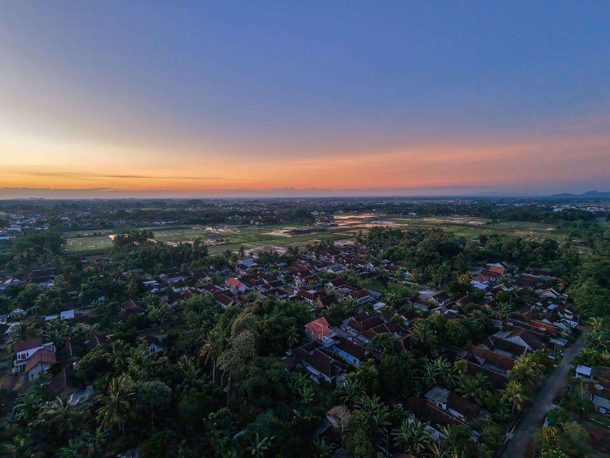 | **senja-desa-aerial** — village among fields at golden hour; the spawn-time target for D19. | [Pexels 38445473](https://www.pexels.com/photo/aerial-view-of-indonesian-village-at-sunset-38445473/) | Pexels License (free, no attribution) | Mytho Digital |
| 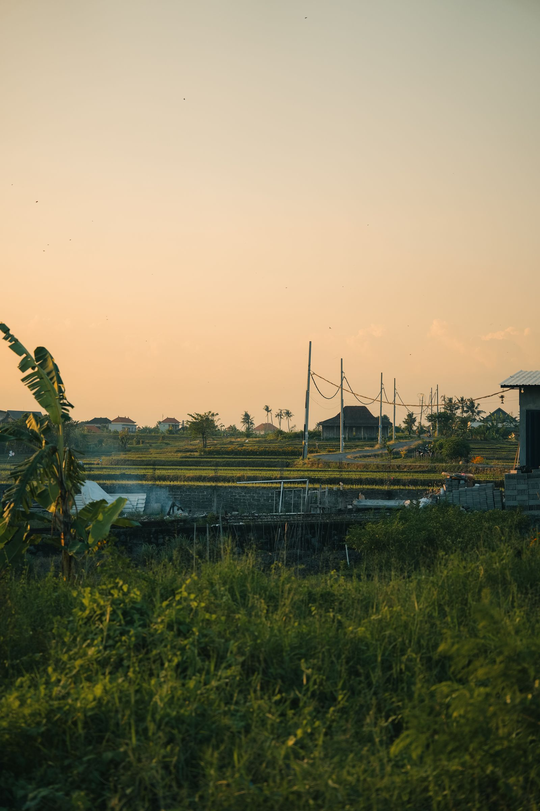 | **senja-rumah-bali** — traditional houses in warm low sun; roof and wall palette. | [Pexels 38363151](https://www.pexels.com/photo/serene-rural-landscape-at-sunset-in-bali-38363151/) | Pexels License (free, no attribution) | Luca Sammarco |
| 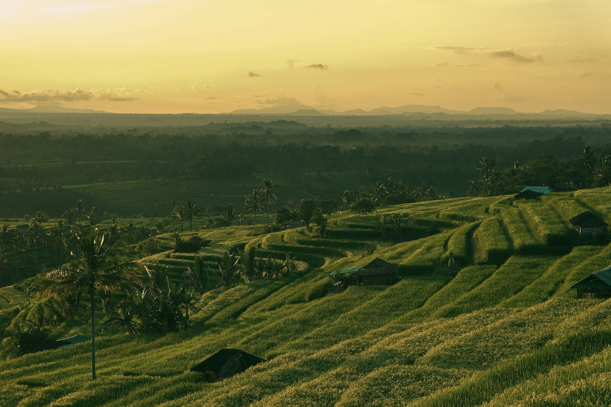 | **sawah-teras-senja-bali** — sawah terraces in golden light; the V-D2 grade target. | [Pexels 32245954](https://www.pexels.com/photo/scenic-rice-terraces-at-sunset-in-bali-32245954/) | Pexels License (free, no attribution) | AHMAD GHANI |
| 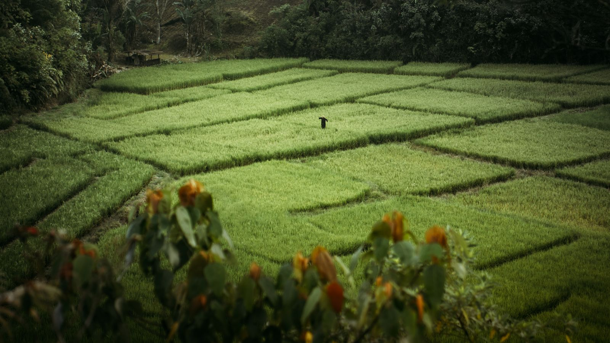 | **sawah-teras-sumbar** — lush terraces in North Sumatra; terracing silhouette and crop density. | [Pexels 39658394](https://www.pexels.com/photo/lush-green-rice-terraces-in-sumatra-indonesia-39658394/) | Pexels License (free, no attribution) | Ondosan Sinaga |
| 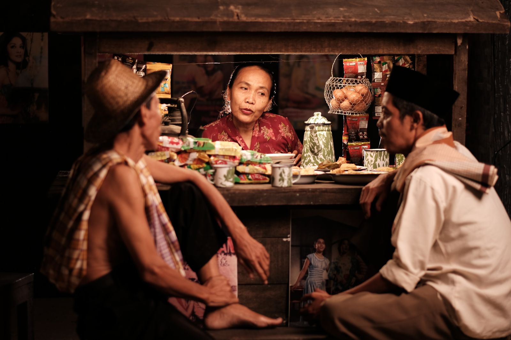 | **pasar-jakarta-stall** — stall interaction; the pasar hub's human scale and counter dressing. | [Pexels 40655435](https://www.pexels.com/photo/indonesian-street-food-stall-in-jakarta-40655435/) | Pexels License (free, no attribution) | Andreas Suwardy |
| 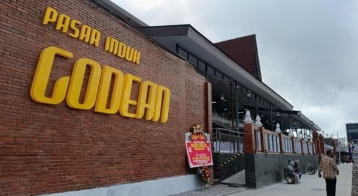 | **pasar-godean-yogyakarta** — real traditional market layout; canopy and aisle rhythm. | [Wikimedia Commons](https://commons.wikimedia.org/wiki/File:Godean_traditional_market_in_Yogyakarta.jpg) | Public domain (Indonesian government work) | Police office of Indonesia |
| 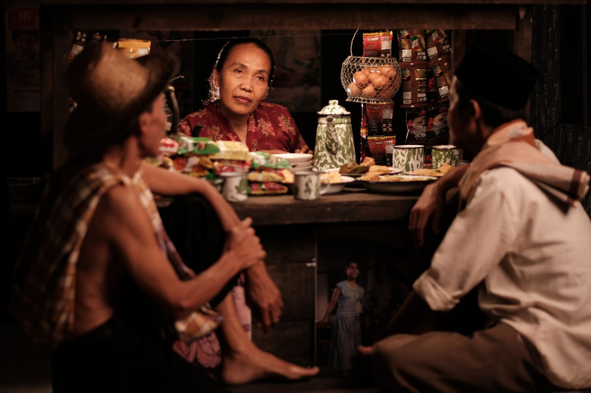 | **warung-jakarta-malam** — lit warung at night; the readable-night lamp target for D19. | [Pexels 40655437](https://www.pexels.com/photo/intimate-nighttime-gathering-in-jakarta-warung-40655437/) | Pexels License (free, no attribution) | Andreas Suwardy |
| 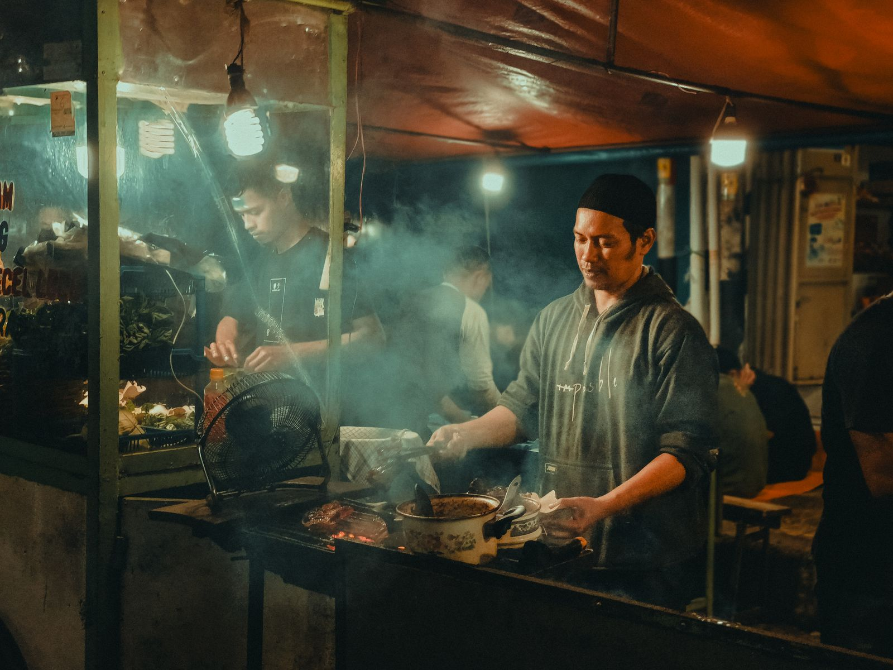 | **warung-masak-malam-java** — food vendors under a tent at night; warm practical light. | [Pexels 23516566](https://www.pexels.com/photo/men-cooking-street-food-in-a-tent-at-night-23516566/) | Pexels License (free, no attribution) | sirhan bahasuan |
| 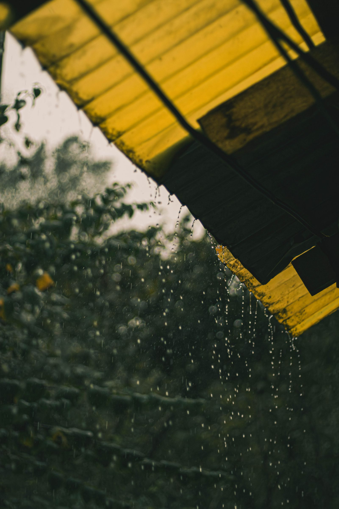 | **hujan-seng-kuning** — rain off seng; the wet-season weather reference. | [Pexels 18782936](https://www.pexels.com/photo/raindrops-falling-down-from-roof-18782936/) | Pexels License (free, no attribution) | malkocoglu.raw |
| 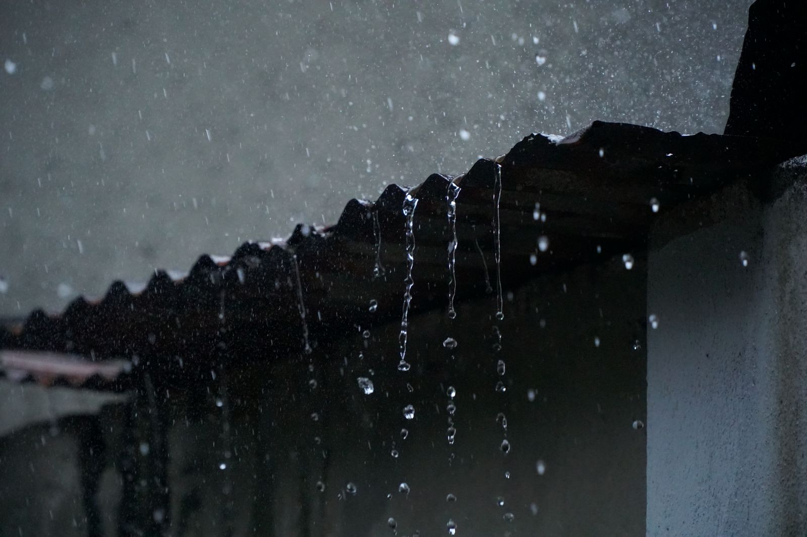 | **hujan-seng-lowlight** — low-light rain; fog and reduced-saturation cue for `hujan`. | [Pexels 9586506](https://www.pexels.com/photo/water-droplets-on-a-roof-9586506/) | Pexels License (free, no attribution) | Nguyễn Hữu Nhã |
| 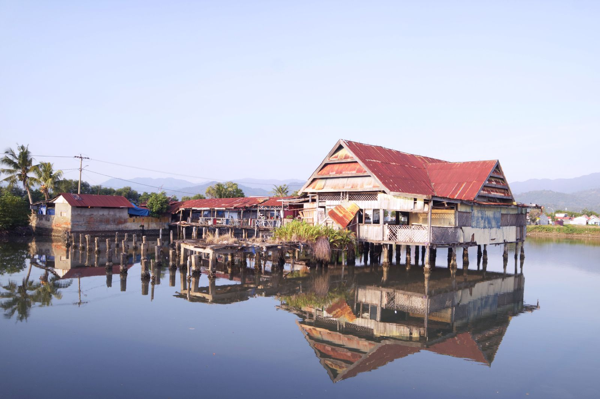 | **rumah-panggung-sulawesi** — rumah panggung form; the building silhouette for item 4. | [Pexels 33777433](https://www.pexels.com/photo/traditional-stilt-house-in-south-sulawesi-indonesia-33777433/) | Pexels License (free, no attribution) | tuan pans |
| 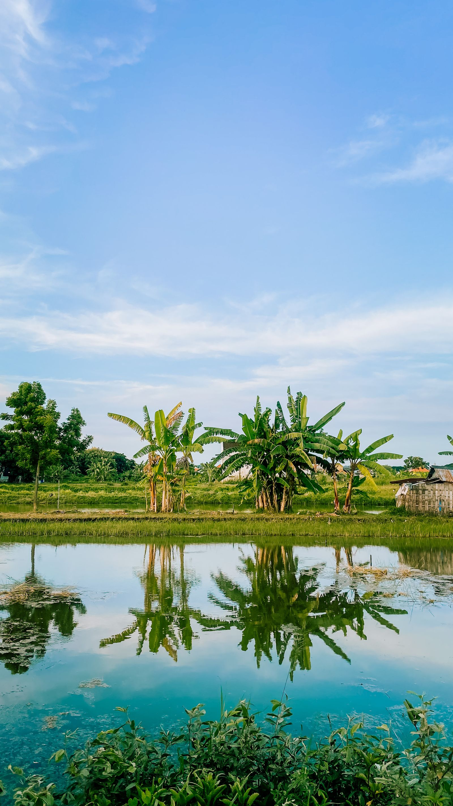 | **pisang-rawa-jatim** — pisang in wet ground; tropical (not pine) backdrop for V-D4. | [Pexels 16837423](https://www.pexels.com/photo/tropical-wetland-with-banana-trees-16837423/) | Pexels License (free, no attribution) | Diq Fahmi_ |
| 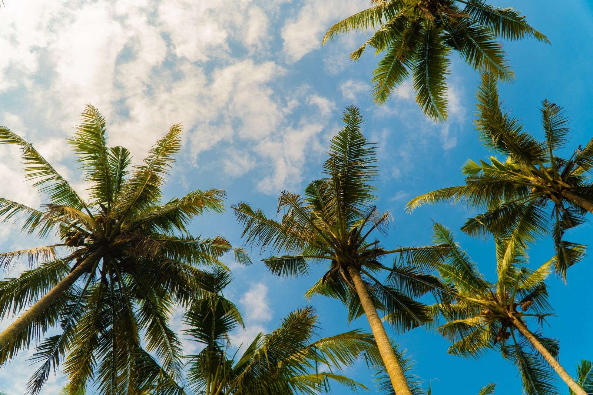 | **kelapa-langit-bali** — kelapa canopy against sky; the other V-D4 backdrop tree. | [Pexels 8584246](https://www.pexels.com/photo/coconut-trees-under-blue-sky-8584246/) | Pexels License (free, no attribution) | Brian photograpy |
| 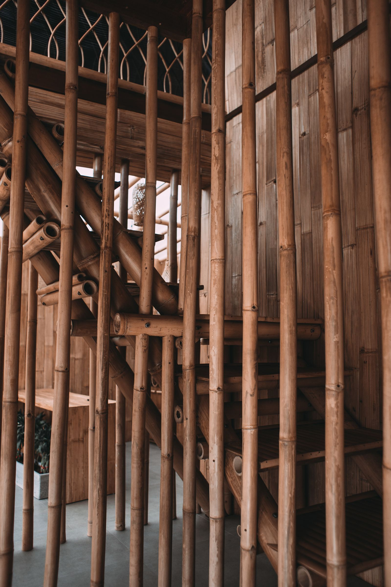 | **bambu-tangga-bali** — bamboo fence construction; the fence prop for item 6. | [Pexels 4577658](https://www.pexels.com/photo/bamboo-fence-and-stairs-in-asian-construction-4577658/) | Pexels License (free, no attribution) | Rachel Claire |
| 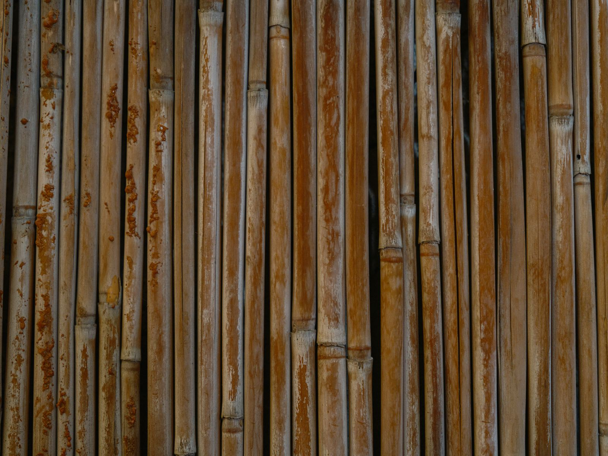 | **bambu-anyaman-detail** — woven bamboo texture; material detail, not an Indonesian location. | [Pexels 16748571](https://www.pexels.com/photo/close-up-of-bamboo-fence-16748571/) | Pexels License (free, no attribution) | Engin Akyurt |

## Gaps and substitutions

- No verified CC0/Public-domain image was obtainable for **warung at night**, **rain on seng** or
  **Indonesian rumah panggung**; free-licence Pexels substitutes were used and are labelled above.
  `pasar-godean-yogyakarta.jpg` is the only public-domain image and is low resolution (598×328) —
  layout reference only, not a texture source.
- The original CC0 Wikimedia candidates for Sumatra terraces (`Jorong_rampanai.jpg`) and a woven
  bamboo fence (`Ferns_on_a_lawn_beside_a_bamboo_fence,_Lan_Su_Chinese_Garden.jpg`) returned HTTP
  429 on every thumb and original download attempt. Both were replaced with verified Pexels images
  under the suggested filenames, so the board stays at 15. The bamboo detail shot is a texture
  reference from a non-Indonesian location; that is stated in its caption.
- Captions are descriptive, not a visual verdict. Designers decide yes/no in
  `docs/v2/visual/CANDIDATES.md`; this board only supplies shared visual targets.
